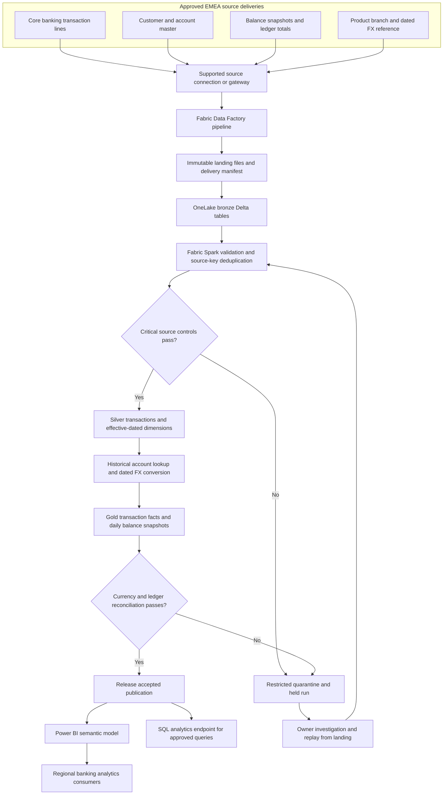
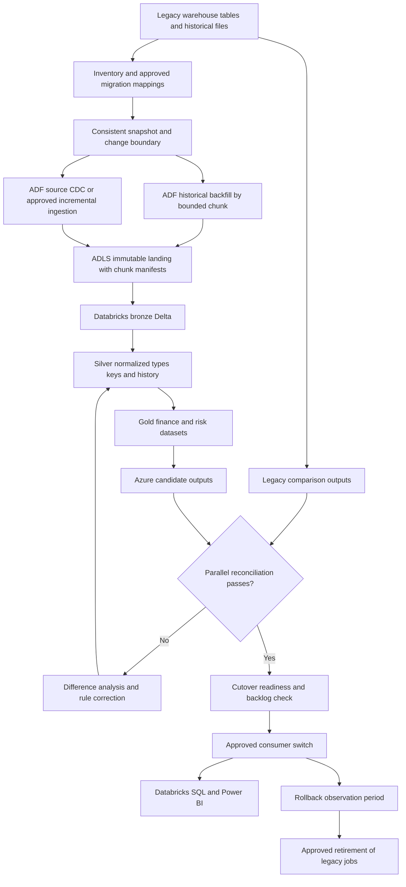
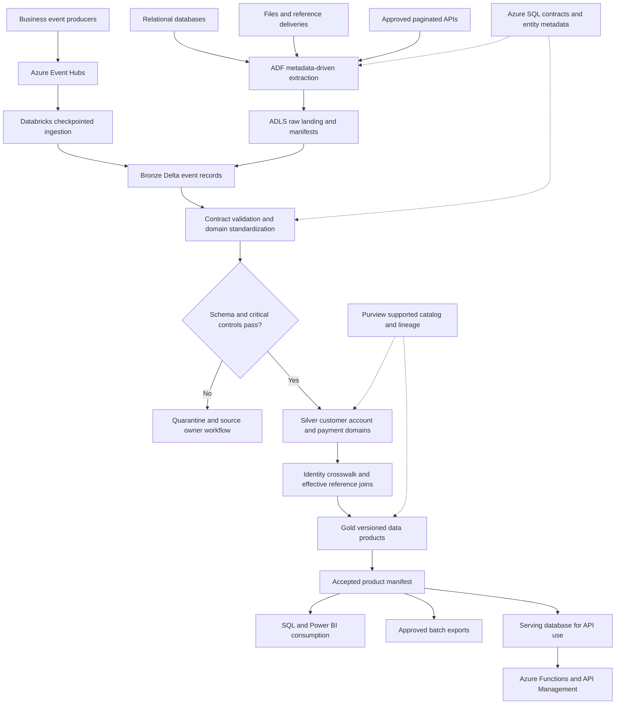
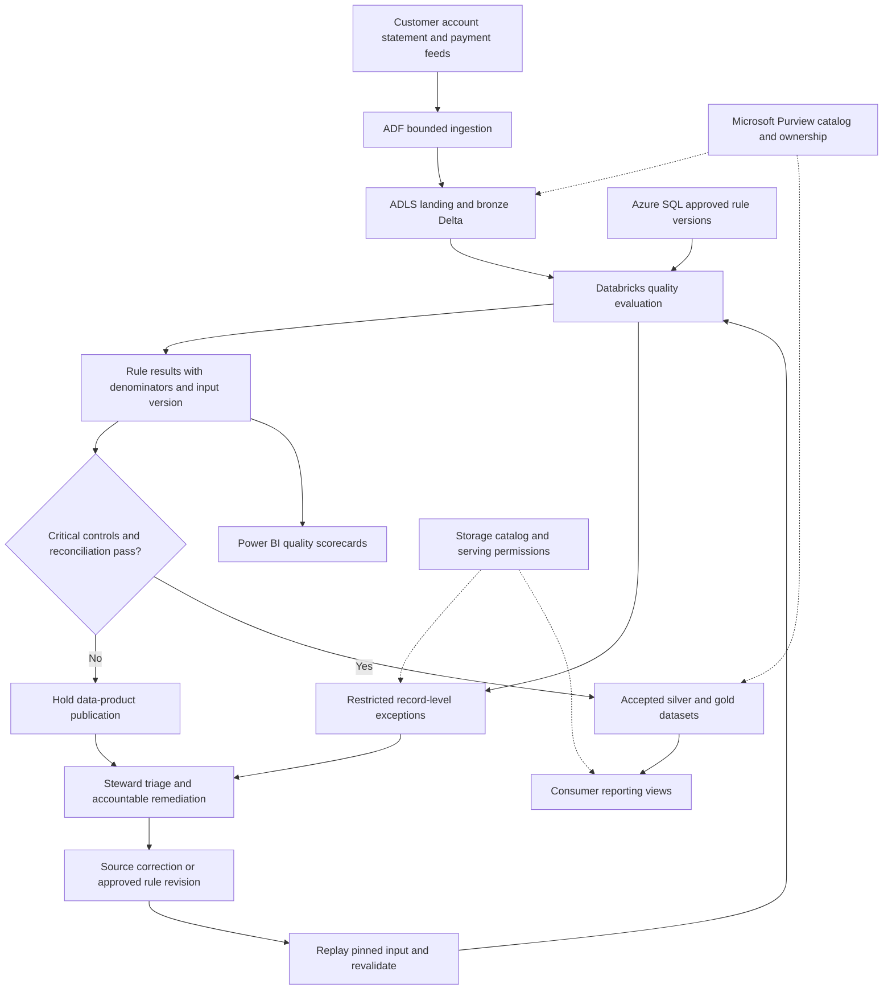
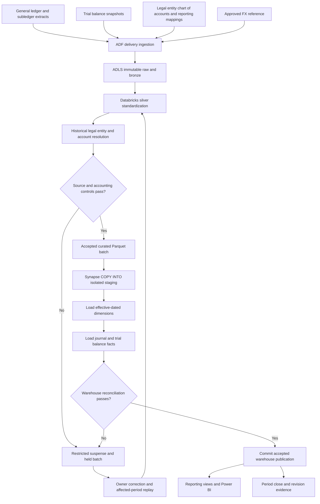
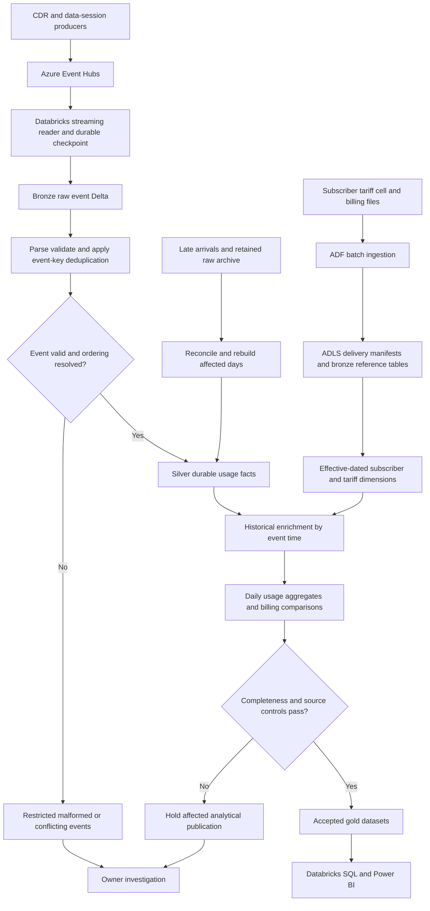

# Full project flow diagram atlas

This Markdown document collects the six full data-flow diagrams. Open each detailed project document for its complete runtime sequence, business transformation, lifecycle, recovery, security and deployment diagrams, plus stage explanations and worked examples. All architectures remain proposed reference designs until verified against actual experience.

Mermaid-capable Markdown viewers render the diagrams. Text architecture flows remain available in each project file for viewers without Mermaid support.

## Citi Bank (EMEA): Enterprise Banking Data Analytics Platform on Microsoft Fabric

[Open the full project flow and technical explanation](projects/01_citi_fabric_banking_analytics.md).

## Barclays (RFT-UKC Gen3): Azure Data Lake Modernization

[Open the full project flow and technical explanation](projects/02_barclays_rft_ukc_gen3_modernization.md).

## BNP Paribas: Enterprise Datahub and Data Integration Platform

[Open the full project flow and technical explanation](projects/03_bnp_enterprise_datahub.md).

## Synchrony Financial: Enterprise Data Quality and Governance

[Open the full project flow and technical explanation](projects/04_synchrony_data_quality_governance.md).

## Barclays (RFTBSL & SRP): Financial Data Warehouse Integration

[Open the full project flow and technical explanation](projects/05_barclays_rftbsl_srp_warehouse.md).

## Mobistar: Telecom Data Warehouse Transformation

[Open the full project flow and technical explanation](projects/06_mobistar_telecom_warehouse.md).

