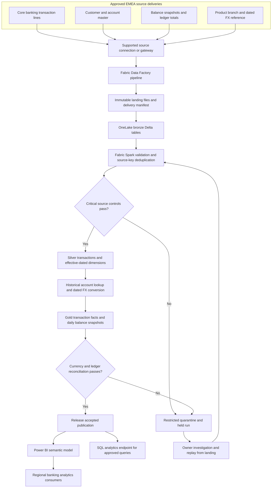
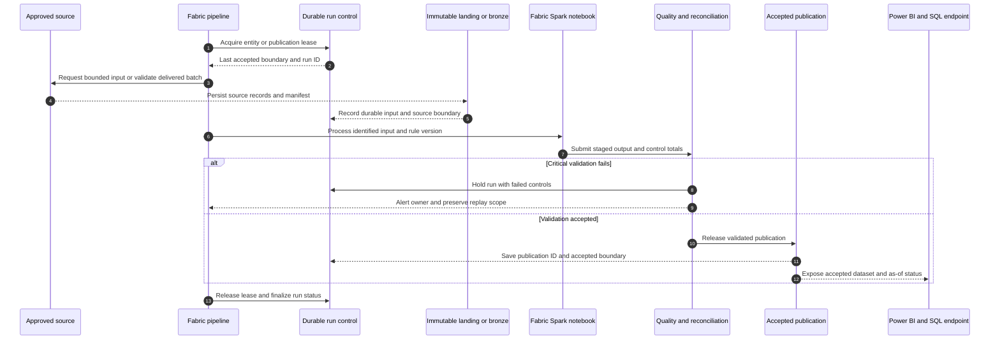
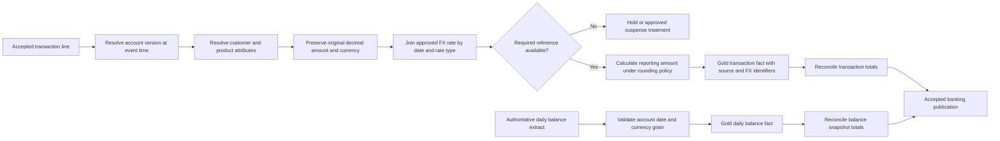
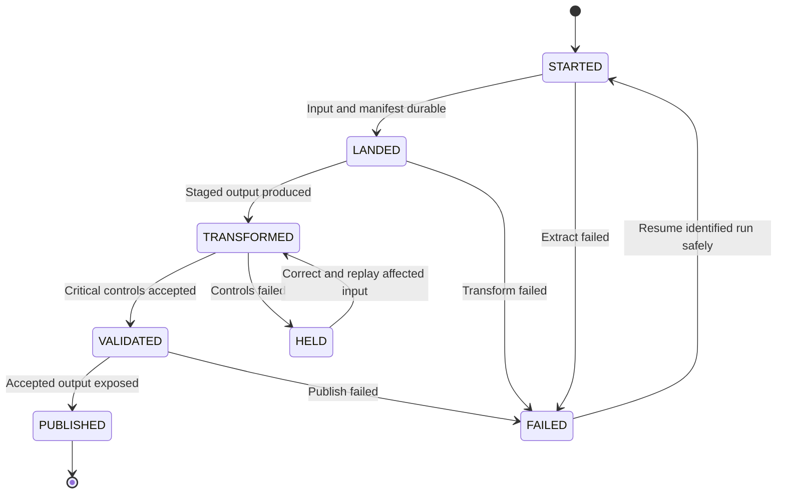
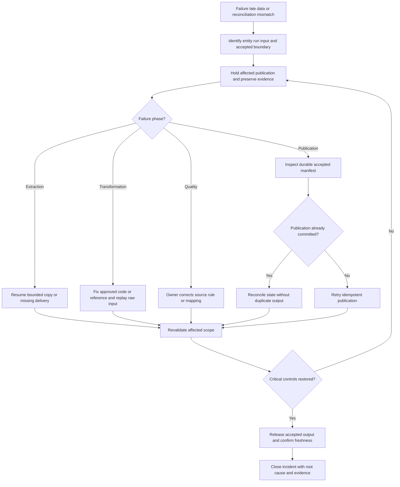
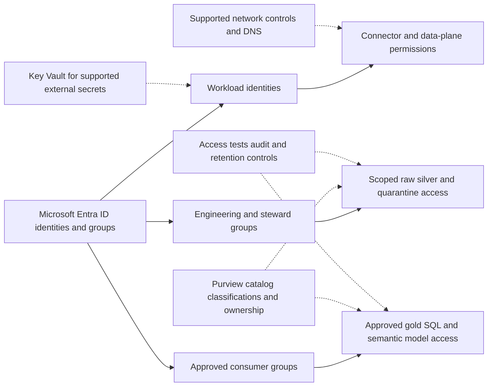
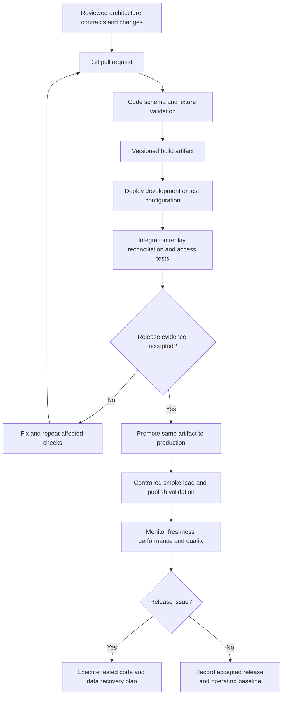

# Citi Bank (EMEA): Enterprise Banking Data Analytics Platform on Microsoft Fabric

> Evidence status: the client and project labels were supplied by the user. Architecture, datasets, responsibilities and implementation below are proposed reference designs for preparation. They are not verified descriptions of a client's internal platform. Replace illustrative details with actual experience before using them as employment claims.

## Project profile

- Target role: Azure Data Engineer / Microsoft Fabric Data Engineer.
- Employer: [actual employer]; client engagement dates: [MM YYYY–MM YYYY].
- Contribution: [what you personally designed/built/operated]; team: [verified size and roles].
- Scale: [verified daily volume, entity count and historical size].
- Outcomes: [baseline, measured result, period and measurement method].

## Business objective

Unify regional banking feeds into a consistent analytical model for balances, transaction activity, product performance, and customer reporting.

## Azure and Microsoft technology stack

Microsoft Fabric Data Factory pipelines, Fabric Spark notebooks, OneLake Delta Lakehouses, Fabric SQL analytics endpoint, Power BI semantic models; Azure ADLS Gen2 for external landing where needed, Azure Key Vault for supported external connections, Microsoft Entra ID, Microsoft Purview, Azure DevOps.

Illustrative sources: core banking transaction extracts, account master, customer master, branch hierarchy, product reference, daily FX rates, and general-ledger control totals. No access to actual Citi systems is assumed.

## End-to-end architecture

```text
Core banking / approved regional extracts --> Azure landing or gateway --> Fabric pipeline --> OneLake bronze --> Fabric Spark silver --> gold Delta tables --> Power BI semantic model --> approved EMEA analytics users
Cross-cutting: identity + access | quality + reconciliation | metadata + lineage | CI/CD + monitoring
```

The source owner provides bounded, identifiable deliveries. Engineering preserves raw input, applies explicit business rules, validates the result and releases only an accepted dataset. Consumers receive a defined product with an owner and freshness contract.

## Data model

| Dataset | Grain | Example columns |
|---|---|---|
| dim_customer | One customer version per effective interval | customer_sk, customer_id, segment, country_code, valid_from, valid_to |
| dim_account | One account version per effective interval | account_sk, account_id, customer_id, product_code, status |
| fact_transaction | One posted transaction line | transaction_id, line_id, account_sk, event_ts, amount, currency_code |
| fact_daily_balance | One account per business date | account_sk, business_date, closing_balance, currency_code |
| fact_fx_rate | One currency pair per rate date and rate type | rate_date, from_currency, to_currency, rate_type, fx_rate |

All names and columns are illustrative. Confirm uniqueness, source precedence, null handling, timezones, history policy and retention before implementing physical tables. A snapshot fact and an event fact require different aggregation rules.

## Technical implementation

### 1. Define reporting contracts

Agree business date by source timezone, reporting currency, transaction grain, reversal handling, balance type, and approved country visibility. Preserve original amounts and rate provenance.

### 2. Ingest regional feeds

Use Fabric pipeline Copy activities through supported connections/gateways. Land files under source/entity/business_date/run_id. Record source count, extract boundary, checksum, and manifest before processing.

### 3. Build bronze tables

Fabric notebooks read immutable landed records with an explicit schema and append source_system, ingestion_ts, run_id, and file_name. Keep malformed rows in a separate restricted dataset.

### 4. Conform silver entities

Normalize timestamp/currency formats; deduplicate transaction line keys by source sequence; resolve account and customer identities. Apply changes and reversals from source semantics. Use Spark Delta writes for Lakehouse mutations.

### 5. Produce gold banking facts

Join transactions to account/customer versions as of event time. Use decimal types for money; join the approved dated FX rate and preserve its identifier. Generate balances from an authoritative balance feed or an agreed opening-balance calculation.

### 6. Reconcile and publish

Compare counts and sums by region, currency, source ledger, and business date before publishing a gold batch. Build Power BI measures for net activity and balances with explicit measure definitions; prevent summing balances across dates.

### 7. Secure and operate

Separate engineering and consumer access. Test Power BI country/region row filters with real role test identities. Validate Lakehouse/OneLake permissions separately because semantic-model filters do not secure underlying files.

## Project-specific SQL example

The snippet illustrates one transformation/control, not an executable project by itself. Create the referenced tables, bind parameters using the selected runtime's supported API, and validate input contracts first.

```sql
-- Spark SQL executed in a Fabric notebook against pre-created Delta tables.
-- Source must contain at most one latest row for each transaction line.
MERGE INTO silver.transaction AS t
USING staging.transaction_latest AS s
ON t.source_system = s.source_system
 AND t.transaction_id = s.transaction_id AND t.line_id = s.line_id
WHEN MATCHED AND s.source_sequence > t.source_sequence THEN UPDATE SET *
WHEN NOT MATCHED THEN INSERT *;
```

## Validation and acceptance

- Reconcile source transaction counts and signed decimal amounts by currency and business date; never combine currencies before conversion.
- Quarantine missing FX rates and unknown accounts instead of silently substituting zero or today's rate.
- Test duplicate transaction lines, reversals, late postings, daylight-saving boundaries, and closed accounts.
- For daily balances, prove that a selected date reports the correct snapshot rather than a sum of historical snapshots.
- Replay the same accepted input twice and verify the business output is unchanged.
- Obtain approval from the business owner using source/control evidence before consumer cutover.

## Failure and recovery example

A late regional transaction arrives for yesterday. Reprocess the affected business date, resolve the historical account version and dated FX rate, rerun currency-level control totals, then release a replacement gold partition. Consumers see only the accepted publication.

Do not advance accepted source state when extraction, validation or publication fails. Resume from durable input and the last accepted boundary; do not resolve data differences by blindly rerunning downstream reports.

## Architecture tradeoff to explain in interviews

Fabric brings orchestration, Spark, OneLake and BI together, but capacity contention and access boundaries need deliberate design. ADLS is an external landing option, not a replacement name for OneLake. The Lakehouse SQL endpoint serves queries; Spark performs Delta table mutations.

## Deployment and production ownership

- Keep development, test, and production resources and identities separate. Provision Azure resources through reviewed Bicep/Terraform and deploy notebooks, SQL, configuration, and pipeline definitions through Azure DevOps.
- Run schema/contract checks and transformation tests on synthetic or approved masked data, followed by integration validation in test. Promote the same reviewed artifact with environment-specific parameters.
- Store supported secrets in Azure Key Vault; prefer managed identity or approved workload identity wherever the connector supports it. Do not embed secrets in notebooks or Markdown.
- Version contracts, business rules and published schemas. Take a recovery point before a destructive schema migration; validate both application rollback and data rollback.
- Record run ID, entity, source boundary, input/output counts, reconciliation result, quality status, execution time and publication ID. Monitor freshness separately from job success.
- Agree actual freshness target, RPO, RTO, support owner and escalation route before go-live. Targets in an interview must be verified, not invented.

## Security implementation

Use Microsoft Entra ID groups and least-privilege workload identities. Apply ADLS RBAC and ACLs, Databricks Unity Catalog grants or Fabric workload/OneLake permissions as appropriate. Limit storage network access through supported private networking, firewalls and validated DNS configuration. Review Fabric connectivity separately; Azure Private Link assumptions do not automatically apply to every Fabric workload. Restrict raw and quarantine zones, mask sensitive attributes in test and consumer datasets, and keep personal data out of logs. Configure Power BI access and row-level security independently of direct data access. Agree residency, retention and deletion requirements with the data owner rather than claiming a platform configuration guarantees compliance.

## Implementation deliverables and release evidence

1. Source inventory, data contract, sample input and expected output.
2. Architecture and identity/connectivity design approved for the environment.
3. Pipeline definitions, notebooks, SQL transformations and configuration metadata.
4. Model dictionary with grain, keys, decimal precision and historical behavior.
5. Test fixtures/results, source reconciliation and signed acceptance record.
6. CI/CD definition, infrastructure code, rollback procedure and cost baseline.
7. Lineage documentation, ownership/access matrix, operating dashboard and runbook.

These documents describe the implementation; they are not a deployed platform or evidence of work performed for the named client. Use the shared implementation handbook for code patterns, an executable build sequence, recovery handling and acceptance templates.


## Interview walkthrough

Use this sequence with your actual details: explain the business requirement; identify sources and their grain; draw the end-to-end flow; explain your personal contribution; describe one transformation and one control; walk through a failure/recovery; explain a measured optimization and its tradeoff; state the accepted result.

Practice these questions:

1. Why were these Azure services selected, and what alternative did you evaluate?
2. How were inserts, updates, deletes, duplicates and late data handled?
3. What proved the published data was complete and financially/operationally correct?
4. How did you prevent exposure through raw files, SQL, BI and exception logs?
5. How did you deploy, roll back, replay and recover the platform?
6. Which parts did you personally implement, and what evidence supports the claimed impact?

## Resume-ready project bullets — use only if verified

- Built [verified scope] Fabric ingestion pipelines and Spark transformations for banking transactions, account data, and daily balances.
- Implemented bronze/silver/gold Delta tables in OneLake with replayable batches and source-to-target financial reconciliation.
- Delivered reporting-ready banking facts and Power BI semantic models with tested regional access controls.
- Reduced [measured runtime/manual effort] from [baseline] to [result] through [verified optimization].

## Technical references

The following official references support the platform patterns, not the named client's implementation.

- [Fabric medallion lakehouse architecture](https://learn.microsoft.com/en-us/fabric/onelake/onelake-medallion-lakehouse-architecture)
- [Fabric end-to-end lakehouse tutorial](https://learn.microsoft.com/en-us/fabric/data-engineering/tutorial-lakehouse-introduction)
- [ADF incremental ingestion with watermarks](https://learn.microsoft.com/en-us/azure/data-factory/tutorial-incremental-copy-portal)
- [Azure Databricks MERGE reference](https://learn.microsoft.com/en-us/azure/databricks/sql/language-manual/delta-merge-into)
- [Azure Databricks change data feed](https://learn.microsoft.com/en-us/azure/databricks/delta/delta-change-data-feed)
- [Microsoft Purview governance setup](https://learn.microsoft.com/en-us/purview/data-governance-get-started)

<!-- EXPANDED_FLOW_START -->

## Full flow diagrams and detailed execution narrative

The following diagrams expand the entire reference project lifecycle. Solid arrows indicate the stated data or workflow direction; dotted arrows indicate supporting configuration, catalog or security relationships. These are proposed designs and must be checked against the actual engagement.

### Diagram 1: Complete project data flow




**How to read the diagram:** start with the source groups, follow ingestion into durable raw/bronze data, then follow validated transformations into the accepted serving dataset. The rejection paths are part of the production flow: a held run retains its input and evidence so the owner can investigate and engineering can replay the affected scope. Raw inputs, staged output and accepted publications are different artifacts.

### Source-to-output contracts

| Input group | Business grain | Ingestion contract | Result |
|---|---|---|---|
| Transactions | Transaction + line + source system | Bounded change feed or approved extract | Signed posted activity; reversals retain their source identity |
| Accounts and customers | Source key plus effective interval | Snapshot followed by ordered changes | Historical versions used by event-time fact joins |
| FX rates | Pair + rate date + approved rate type | Validated reference delivery | Original amount plus converted amount and rate provenance |
| Daily balances | Account + business date + currency | Authoritative daily snapshot | Snapshot totals; no summation across reporting dates |

For every input, confirm the owner, business key, event/effective timestamp, source change sequence, extraction boundary, deletion semantics and reference dependencies. Choose snapshot, watermark, CDC or event ingestion from those semantics. Do not assume a file delivery is complete merely because the file is readable.

### Diagram 2: Runtime interaction from source to consumer




This sequence describes an accepted batch or publication cycle. For streaming, raw events are persisted continuously and product publication follows the chosen microbatch/date policy; an ADF schedule is not required for every event. The control store holds durable state, while the accepted publication records the actual output exposed to consumers. Where these sit in different systems, recovery reconciles their manifests instead of assuming a shared atomic transaction.

### Detailed stage explanations

### Stage 1: Define reporting contracts

Agree business date by source timezone, reporting currency, transaction grain, reversal handling, balance type, and approved country visibility. Preserve original amounts and rate provenance.

**Execution evidence:** record the input scope, source/run boundary, applicable contract or rule version, produced artifact and acceptance status for this stage. The next dependent stage consumes its accepted output; an execution timestamp alone is insufficient evidence of correctness.

### Stage 2: Ingest regional feeds

Use Fabric pipeline Copy activities through supported connections/gateways. Land files under source/entity/business_date/run_id. Record source count, extract boundary, checksum, and manifest before processing.

**Execution evidence:** record the input scope, source/run boundary, applicable contract or rule version, produced artifact and acceptance status for this stage. The next dependent stage consumes its accepted output; an execution timestamp alone is insufficient evidence of correctness.

### Stage 3: Build bronze tables

Fabric notebooks read immutable landed records with an explicit schema and append source_system, ingestion_ts, run_id, and file_name. Keep malformed rows in a separate restricted dataset.

**Execution evidence:** record the input scope, source/run boundary, applicable contract or rule version, produced artifact and acceptance status for this stage. The next dependent stage consumes its accepted output; an execution timestamp alone is insufficient evidence of correctness.

### Stage 4: Conform silver entities

Normalize timestamp/currency formats; deduplicate transaction line keys by source sequence; resolve account and customer identities. Apply changes and reversals from source semantics. Use Spark Delta writes for Lakehouse mutations.

**Execution evidence:** record the input scope, source/run boundary, applicable contract or rule version, produced artifact and acceptance status for this stage. The next dependent stage consumes its accepted output; an execution timestamp alone is insufficient evidence of correctness.

### Stage 5: Produce gold banking facts

Join transactions to account/customer versions as of event time. Use decimal types for money; join the approved dated FX rate and preserve its identifier. Generate balances from an authoritative balance feed or an agreed opening-balance calculation.

**Execution evidence:** record the input scope, source/run boundary, applicable contract or rule version, produced artifact and acceptance status for this stage. The next dependent stage consumes its accepted output; an execution timestamp alone is insufficient evidence of correctness.

### Stage 6: Reconcile and publish

Compare counts and sums by region, currency, source ledger, and business date before publishing a gold batch. Build Power BI measures for net activity and balances with explicit measure definitions; prevent summing balances across dates.

**Execution evidence:** record the input scope, source/run boundary, applicable contract or rule version, produced artifact and acceptance status for this stage. The next dependent stage consumes its accepted output; an execution timestamp alone is insufficient evidence of correctness.

### Stage 7: Secure and operate

Separate engineering and consumer access. Test Power BI country/region row filters with real role test identities. Validate Lakehouse/OneLake permissions separately because semantic-model filters do not secure underlying files.

**Execution evidence:** record the input scope, source/run boundary, applicable contract or rule version, produced artifact and acceptance status for this stage. The next dependent stage consumes its accepted output; an execution timestamp alone is insufficient evidence of correctness.

### Diagram 3: Project-specific business transformation




**Business meaning:** Unify regional banking feeds into a consistent analytical model for balances, transaction activity, product performance, and customer reporting. The diagram highlights where the project-specific rules alter the data's meaning, grain or reporting status. Technical success at these stages does not substitute for the business control evidence described below.

### Worked record journey

Consider an illustrative transaction line `TX100 / 1` for account `A100`, posted at 10:00 UTC on 2026-10-01, with an original amount of EUR 100.00. The account is mapped to the customer version effective at 10:00, and the approved EUR-to-reporting-currency rate for that business date is looked up. If the illustrative rate were 1.10, the converted amount would be 110.00 before any agreed rounding; the actual rate must come from the approved reference feed.

Bronze retains the received row and delivery ID. Silver retains its business key, source sequence, original amount, and historical dimension references. Gold retains both currencies, amounts, and the FX identifier so a reviewer can explain the conversion. A duplicate with the same source sequence does not increase the transaction total. A higher-sequence correction supersedes the current line and triggers reconciliation of the affected day. A reversal is represented according to the source contract, preserving a link to the original transaction.

An account's closing balance comes from the approved snapshot or an agreed balance derivation with an opening value and complete posted activity. The semantic model returns a selected-date snapshot. It must not add ten daily closing balances and present the sum as the account's current balance.

The example is synthetic and demonstrates behavior, not actual client data or a measured client outcome. Trace a record using its source business key, source sequence, raw location, run ID, contract/rule version and accepted publication ID. Avoid putting sensitive payload values in general logs.

### Dependencies, scheduling and publication boundaries

Customer/account and reference versions must be accepted before dependent transaction facts are resolved. FX availability is required for reporting-currency facts. Balance publication can have its own accepted boundary if its contract is independent; the combined report must display the relevant as-of dates.

Keep a dependency manifest for each publication. It should identify the accepted source/reference versions, transformed partition scope and resulting output version. A successful upstream run is usable only if its controls passed and its artifact matches the downstream contract. Run independent entities concurrently only within the approved resource/source limits; serialize publication where concurrent writers could conflict.

**Suggested parameter contract:** `entity_id`, `run_id`, `business_date` or bounded change range, `contract_version`, `rule_version`, `input_manifest_uri`, `output_stage_uri`, `environment`, and `replay_mode`. Validate values and allow-list identifiers. Use the same input/rule scope during a replay unless the run explicitly records an approved correction.

### Diagram 4: Lifecycle and acceptance states




`STARTED` means a run exists; `LANDED` means its inputs are durable; `TRANSFORMED` means a candidate output exists; `VALIDATED` means the critical checks passed; `PUBLISHED` means consumers can read the accepted output. `HELD` indicates a deliberate business/control stop and `FAILED` indicates an execution failure. Extend the handbook's minimal control-table status constraint if you implement these additional states. The diagram is a recommended lifecycle, not a claim that the existing example DDL already includes every state.

Track state transitions with timestamps, actor/workload identity, reason and artifact IDs. A retry is an attempt tied to the original business input. Replaying a publication should not create extra fact rows, duplicate daily aggregates or misleading extra accepted runs.

### Diagram 5: Error handling, late correction and recovery




**Project recovery scenario:** A late regional transaction arrives for yesterday. Reprocess the affected business date, resolve the historical account version and dated FX rate, rerun currency-level control totals, then release a replacement gold partition. Consumers see only the accepted publication.

Before retrying, determine whether the failure occurred before or after publication. A run can publish successfully and fail while recording its state; a blind repeat can double-count outputs. Inspect the accepted manifest, compare expected key/count/control evidence, and complete or roll back the recorded state safely. Missing or corrupt inputs require source correction; transformation fixes require versioned code; business-control failures require the relevant owner's resolution.

For a late correction, identify affected event dates, historical dimension intervals and dependent aggregate/reporting periods. Recompute the smallest complete business scope rather than updating only an arbitrary file. Preserve old publication metadata and make consumer as-of/revision information clear.

### Diagram 6: Identity, access and governance flow




Permissions are enforced at the workload, storage/catalog and serving layers used by this project. The catalog documents ownership and classification; permissions still need implementation and testing. Validate engineer, workload, steward and consumer paths independently, including raw, quarantine, direct SQL and dashboard exports. A masked dashboard does not justify unrestricted raw access.

Use approved identities for source connections and pipeline execution. Key Vault applies to supported external-secret scenarios; configure Fabric connection credentials through supported mechanisms rather than assuming Azure managed identity works identically for every connector. Network restrictions, retention and residency settings are environment-specific controls to verify during deployment.

### Diagram 7: Development-to-production deployment flow




Create source contracts, physical schemas and fixtures before building the complete pipeline. Deploy infrastructure and configuration first, then compatible tables and transformations, then orchestration and serving objects. Test one vertical slice before adding volume or source variants. Promote reviewed artifacts with separate environment parameters and identities. Confirm the selected Azure/Fabric item's deployment support instead of assuming every object uses the same release mechanism.

Production smoke validation checks source reachability, identity permissions, small bounded processing, accepted publication and consumer reads. If a release changes stored data/schema, the rollback plan must cover those data changes as well as code. Record who owns the decision and where the recovery evidence is stored.

### Consumer request and reporting behavior

A banking analyst filters country, product and business date in the semantic model. Measures use accepted transaction facts and selected-date balance facts. An authorized engineer querying the SQL endpoint still needs underlying data permissions; semantic-model row filters are verified separately.

Every product should expose its grain, accepted as-of boundary, revision/contract version, freshness status, business owner and access route. Serving queries should select accepted output; do not expose unvalidated staging by accident. If multiple datasets publish independently, the report must handle and display their differing as-of dates.

### Observability from ingestion through consumption

| Layer | What to record or measure | What the signal establishes |
|---|---|---|
| Source/landing | Boundary, delivery IDs, source counts, manifests, completeness | Whether all expected input arrived |
| Transformation | Rule/code version, input/output scope, rejected rows, duration | Which logic ran on which records |
| Validation | Key coverage, decimal totals, rule results, accepted status | Whether the output meets its contract |
| Publication | Dataset version, accepted boundary, publication ID | Exactly what consumers can read |
| Consumption | Access-test outcomes, serving errors, query latency | Whether authorized users can use the product |
| Recovery | Failed phase, replay input, replacement publication, controls | Whether service was restored correctly |

Measure Fabric capacity utilization, notebook duration, reference-join volume and BI query latency. Use explicit schemas and incremental affected-date processing first; tune capacity or layout only after identifying the bottleneck.

Alert on accepted-data age as well as job failure. A pipeline can finish successfully while a source feed is stale or the product remains held. Dashboard a last accepted timestamp and business freshness target, and route each alert to its actual owning team.

### Project-specific completion and interview evidence

- Reconcile source transaction counts and signed decimal amounts by currency and business date; never combine currencies before conversion.
- Quarantine missing FX rates and unknown accounts instead of silently substituting zero or today's rate.
- Test duplicate transaction lines, reversals, late postings, daylight-saving boundaries, and closed accounts.
- For daily balances, prove that a selected date reports the correct snapshot rather than a sum of historical snapshots.
- Demonstrate normal flow, rejected flow, duplicate replay and a late correction using synthetic/approved fixtures.
- Verify the diagram against deployed resources, connections, code and actual publication artifacts.
- Keep one accepted-run evidence packet linking manifest, controls, serving dataset and consumer acceptance.
- Replace illustrative names, example dates, sources and targets with verified engagement details before discussing them as past experience.

**Interview explanation:** draw Diagram 1, describe the worked record journey, identify your own implemented stages, explain Diagram 3's business rules, show how the critical gate protects publication, then use Diagram 5 to explain a concrete recovery. Finish with the verified output and a measured result supported by evidence.

### Plain-text fallback flow

Some Markdown viewers do not render Mermaid. The original architecture section and the following text retain the core flow in those viewers:

```text
Core banking / approved regional extracts --> Azure landing or gateway --> Fabric pipeline --> OneLake bronze --> Fabric Spark silver --> gold Delta tables --> Power BI semantic model --> approved EMEA analytics users
1. Confirm source contract and accepted dependencies.
2. Persist identifiable raw input and manifest.
3. Apply ordered, versioned business transformations.
4. Validate critical rules and source-to-target controls.
5. On failure: hold -> investigate -> correct -> replay -> revalidate.
6. On acceptance: publish -> record accepted boundary -> expose to consumers.
7. Monitor freshness, correctness, access, performance and recovery.
```
