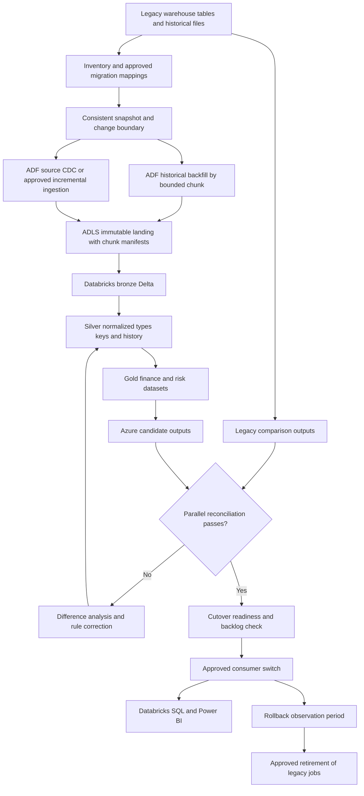
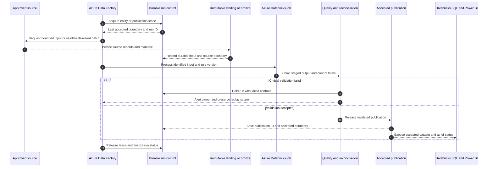
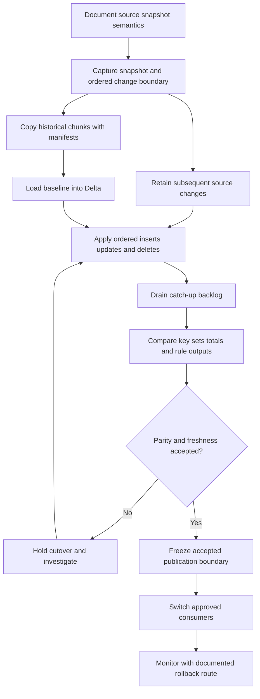
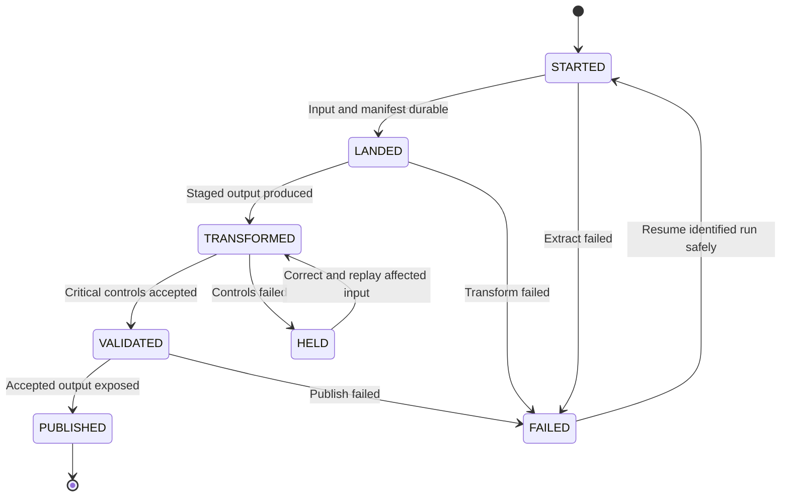
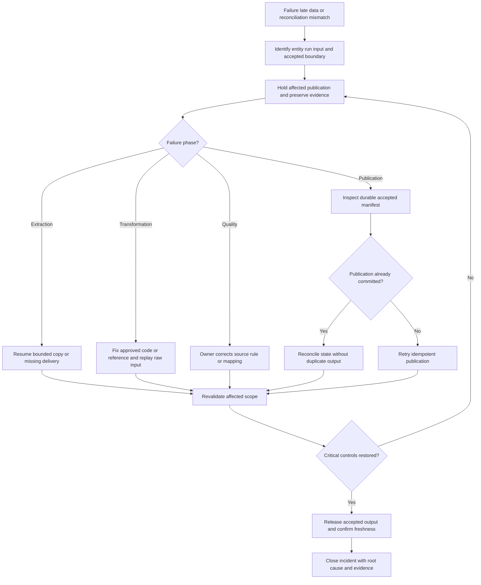
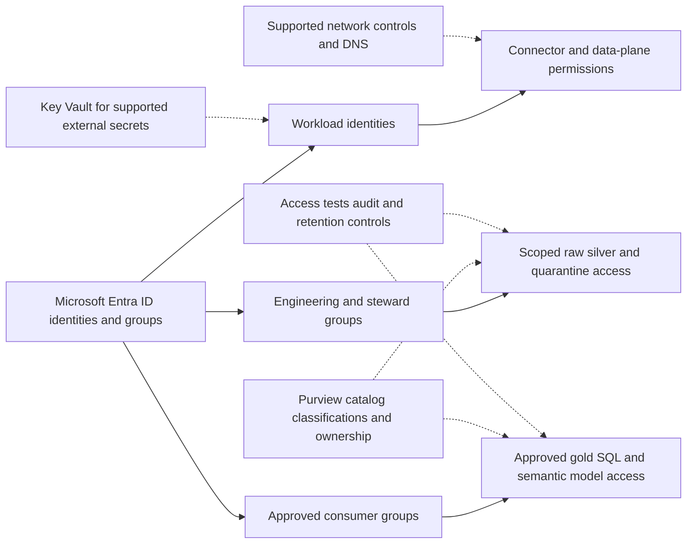
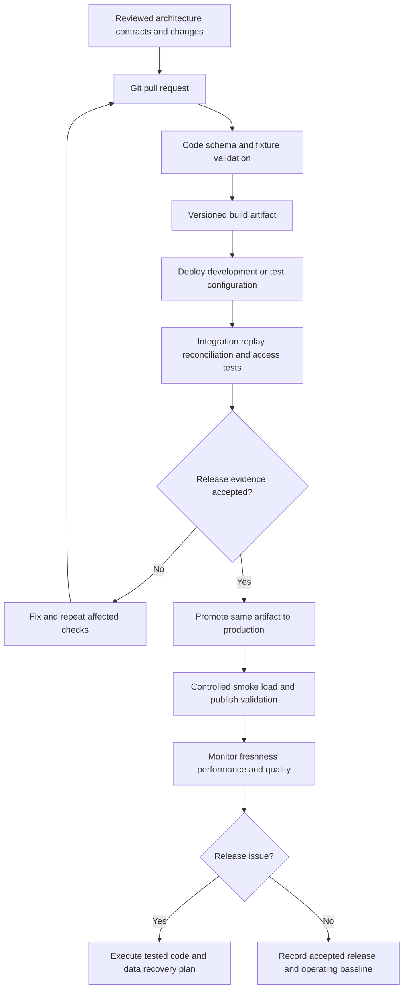

# Barclays (RFT-UKC Gen3): Azure Data Lake Modernization

> Evidence status: the client and project labels were supplied by the user. Architecture, datasets, responsibilities and implementation below are proposed reference designs for preparation. They are not verified descriptions of a client's internal platform. Replace illustrative details with actual experience before using them as employment claims.

## Project profile

- Target role: Azure Data Engineer / Lakehouse Migration Engineer.
- Employer: [actual employer]; client engagement dates: [MM YYYY–MM YYYY].
- Contribution: [what you personally designed/built/operated]; team: [verified size and roles].
- Scale: [verified daily volume, entity count and historical size].
- Outcomes: [baseline, measured result, period and measurement method].

## Business objective

Modernize an illustrative legacy analytical platform into an Azure lakehouse while preserving financial outputs, business rules, and controlled cutover.

## Azure and Microsoft technology stack

Azure Data Factory, self-hosted integration runtime where required, ADLS Gen2, Azure Databricks with Delta Lake and Unity Catalog, Azure SQL Database for orchestration metadata, Azure Key Vault, Microsoft Entra ID, Microsoft Purview, Azure Monitor/Log Analytics, Azure DevOps.

Illustrative sources: legacy warehouse tables, relational source extracts, scheduled file deliveries, account/reference data, position snapshots, and historical partitions. Expand RFT/UKC/Gen3 only using confirmed internal definitions.

## End-to-end architecture

```text
Legacy warehouse / files --> ADF + integration runtime --> ADLS immutable landing --> Databricks bronze --> conformed silver --> gold risk/finance datasets --> Databricks SQL / Power BI
Cross-cutting: identity + access | quality + reconciliation | metadata + lineage | CI/CD + monitoring
```

The source owner provides bounded, identifiable deliveries. Engineering preserves raw input, applies explicit business rules, validates the result and releases only an accepted dataset. Consumers receive a defined product with an owner and freshness contract.

## Data model

| Dataset | Grain | Example columns |
|---|---|---|
| migration_inventory | One source entity and migration version | entity_id, source_object, owner, extract_method, rule_version |
| position_snapshot | One instrument/account/book per business date | position_id, book_id, account_id, instrument_id, business_date, quantity |
| reference_instrument | One instrument version per effective interval | instrument_id, asset_class, currency_code, valid_from, valid_to |
| migration_reconciliation | One comparison per entity/date/control | entity_id, business_date, control_name, legacy_value, azure_value, status |

All names and columns are illustrative. Confirm uniqueness, source precedence, null handling, timezones, history policy and retention before implementing physical tables. A snapshot fact and an event fact require different aggregation rules.

## Technical implementation

### 1. Inventory and baseline

Document upstream/downstream dependencies, schedules, historical volume, source keys, deletion semantics, existing transformation rules, and reconciliation controls. Capture representative legacy output before rewriting logic.

### 2. Build the Azure foundation

Create environment-specific storage, Databricks workspaces, identity/access configuration, catalog schemas, secrets, and metadata tables. Configure private connectivity and DNS where required; validate source connectivity before scheduling loads.

### 3. Backfill history

Extract immutable historical date/key ranges with ADF. Use chunk manifests and bounded concurrency to protect source systems. Convert landed data to bronze Delta with schema contracts; make each chunk independently replayable.

### 4. Catch up changes

Capture a consistent snapshot boundary and ingest later changes from that boundary. Use source-supported CDC for inserts/updates/deletes or timestamp ingestion only where its limitations are acceptable.

### 5. Port transformation rules

Implement conformed silver types, stable business keys, SCD dimensions, and gold aggregates in PySpark/SQL. Version every translated rule and record intentional differences from the legacy logic.

### 6. Run parallel reconciliation

Compare legacy and Azure row counts, keyed records, missing keys, and decimal totals over agreed representative periods. Resolve discrepancies by rule and source; preserve signed-off evidence.

### 7. Cut over and retire

Freeze the publication boundary, drain the change backlog, reconcile, then switch approved consumers. Keep the legacy route available for an agreed rollback period. Retire legacy jobs only after business and operational acceptance.

## Project-specific SQL example

The snippet illustrates one transformation/control, not an executable project by itself. Create the referenced tables, bind parameters using the selected runtime's supported API, and validate input contracts first.

```sql
-- Azure Databricks SQL; staging has one ordered latest change per key.
MERGE INTO silver.position AS t
USING staging.position_latest AS s
ON t.position_id = s.position_id AND t.business_date = s.business_date
WHEN MATCHED AND s.source_sequence > t.source_sequence
 AND s.operation = 'DELETE' THEN DELETE
WHEN MATCHED AND s.source_sequence > t.source_sequence THEN UPDATE SET *
WHEN NOT MATCHED AND s.operation <> 'DELETE' THEN INSERT *;
```

## Validation and acceptance

- Compare record-level hashes after canonical formatting; confirm business meaning through independent totals and key-level samples.
- Prove historical backfill plus catch-up has neither a gap nor duplicate publication at the snapshot boundary.
- Exercise source deletion, corrected historical positions, schema change, and partially failed extraction chunks.
- Measure query and pipeline performance under representative concurrency before choosing cluster sizes.
- Replay the same accepted input twice and verify the business output is unchanged.
- Obtain approval from the business owner using source/control evidence before consumer cutover.

## Failure and recovery example

A backfill chunk fails while catch-up continues. Resume only the failed chunk using its saved boundary and manifest. Do not advance the entity's accepted migration boundary until its reconciliation passes; pause consumer cutover if any critical control differs.

Do not advance accepted source state when extraction, validation or publication fails. Resume from durable input and the last accepted boundary; do not resolve data differences by blindly rerunning downstream reports.

## Architecture tradeoff to explain in interviews

A lift-and-shift speeds initial parity; redesign can improve maintainability but changes more rules at once. Establish parity first and optimize in separately measured increments. Source CDC and Delta change data feed are distinct: downstream Delta CDF cannot capture changes never ingested from the source.

## Deployment and production ownership

- Keep development, test, and production resources and identities separate. Provision Azure resources through reviewed Bicep/Terraform and deploy notebooks, SQL, configuration, and pipeline definitions through Azure DevOps.
- Run schema/contract checks and transformation tests on synthetic or approved masked data, followed by integration validation in test. Promote the same reviewed artifact with environment-specific parameters.
- Store supported secrets in Azure Key Vault; prefer managed identity or approved workload identity wherever the connector supports it. Do not embed secrets in notebooks or Markdown.
- Version contracts, business rules and published schemas. Take a recovery point before a destructive schema migration; validate both application rollback and data rollback.
- Record run ID, entity, source boundary, input/output counts, reconciliation result, quality status, execution time and publication ID. Monitor freshness separately from job success.
- Agree actual freshness target, RPO, RTO, support owner and escalation route before go-live. Targets in an interview must be verified, not invented.

## Security implementation

Use Microsoft Entra ID groups and least-privilege workload identities. Apply ADLS RBAC and ACLs, Databricks Unity Catalog grants or Fabric workload/OneLake permissions as appropriate. Limit storage network access through supported private networking, firewalls and validated DNS configuration. Review Fabric connectivity separately; Azure Private Link assumptions do not automatically apply to every Fabric workload. Restrict raw and quarantine zones, mask sensitive attributes in test and consumer datasets, and keep personal data out of logs. Configure Power BI access and row-level security independently of direct data access. Agree residency, retention and deletion requirements with the data owner rather than claiming a platform configuration guarantees compliance.

## Implementation deliverables and release evidence

1. Source inventory, data contract, sample input and expected output.
2. Architecture and identity/connectivity design approved for the environment.
3. Pipeline definitions, notebooks, SQL transformations and configuration metadata.
4. Model dictionary with grain, keys, decimal precision and historical behavior.
5. Test fixtures/results, source reconciliation and signed acceptance record.
6. CI/CD definition, infrastructure code, rollback procedure and cost baseline.
7. Lineage documentation, ownership/access matrix, operating dashboard and runbook.

These documents describe the implementation; they are not a deployed platform or evidence of work performed for the named client. Use the shared implementation handbook for code patterns, an executable build sequence, recovery handling and acceptance templates.


## Interview walkthrough

Use this sequence with your actual details: explain the business requirement; identify sources and their grain; draw the end-to-end flow; explain your personal contribution; describe one transformation and one control; walk through a failure/recovery; explain a measured optimization and its tradeoff; state the accepted result.

Practice these questions:

1. Why were these Azure services selected, and what alternative did you evaluate?
2. How were inserts, updates, deletes, duplicates and late data handled?
3. What proved the published data was complete and financially/operationally correct?
4. How did you prevent exposure through raw files, SQL, BI and exception logs?
5. How did you deploy, roll back, replay and recover the platform?
6. Which parts did you personally implement, and what evidence supports the claimed impact?

## Resume-ready project bullets — use only if verified

- Migrated [verified entities/history] from a legacy platform to ADLS Gen2 and Azure Databricks using ADF orchestration.
- Implemented restartable backfill, incremental processing, and schema validation with Delta Lake.
- Translated legacy business rules into PySpark/SQL and validated outputs through parallel reconciliation.
- Improved [measured processing/query metric] by [verified amount] and supported a controlled consumer cutover.

## Technical references

The following official references support the platform patterns, not the named client's implementation.

- [Fabric medallion lakehouse architecture](https://learn.microsoft.com/en-us/fabric/onelake/onelake-medallion-lakehouse-architecture)
- [Fabric end-to-end lakehouse tutorial](https://learn.microsoft.com/en-us/fabric/data-engineering/tutorial-lakehouse-introduction)
- [ADF incremental ingestion with watermarks](https://learn.microsoft.com/en-us/azure/data-factory/tutorial-incremental-copy-portal)
- [Azure Databricks MERGE reference](https://learn.microsoft.com/en-us/azure/databricks/sql/language-manual/delta-merge-into)
- [Azure Databricks change data feed](https://learn.microsoft.com/en-us/azure/databricks/delta/delta-change-data-feed)
- [Microsoft Purview governance setup](https://learn.microsoft.com/en-us/purview/data-governance-get-started)

<!-- EXPANDED_FLOW_START -->

## Full flow diagrams and detailed execution narrative

The following diagrams expand the entire reference project lifecycle. Solid arrows indicate the stated data or workflow direction; dotted arrows indicate supporting configuration, catalog or security relationships. These are proposed designs and must be checked against the actual engagement.

### Diagram 1: Complete project data flow




**How to read the diagram:** start with the source groups, follow ingestion into durable raw/bronze data, then follow validated transformations into the accepted serving dataset. The rejection paths are part of the production flow: a held run retains its input and evidence so the owner can investigate and engineering can replay the affected scope. Raw inputs, staged output and accepted publications are different artifacts.

### Source-to-output contracts

| Input group | Business grain | Ingestion contract | Result |
|---|---|---|---|
| Historical facts | Source business key + historical date | Bounded snapshot chunks | Replayable migrated history |
| Position changes | Position key + source sequence | Source-supported CDC where available | Current or historical position state with deletion semantics |
| Instrument/account reference | Entity key + effective interval | Snapshot and ordered changes | Stable historical joins |
| Parity evidence | Entity + date + comparison control | Parallel legacy/Azure execution | Accepted differences and cutover evidence |

For every input, confirm the owner, business key, event/effective timestamp, source change sequence, extraction boundary, deletion semantics and reference dependencies. Choose snapshot, watermark, CDC or event ingestion from those semantics. Do not assume a file delivery is complete merely because the file is readable.

### Diagram 2: Runtime interaction from source to consumer




This sequence describes an accepted batch or publication cycle. For streaming, raw events are persisted continuously and product publication follows the chosen microbatch/date policy; an ADF schedule is not required for every event. The control store holds durable state, while the accepted publication records the actual output exposed to consumers. Where these sit in different systems, recovery reconciles their manifests instead of assuming a shared atomic transaction.

### Detailed stage explanations

### Stage 1: Inventory and baseline

Document upstream/downstream dependencies, schedules, historical volume, source keys, deletion semantics, existing transformation rules, and reconciliation controls. Capture representative legacy output before rewriting logic.

**Execution evidence:** record the input scope, source/run boundary, applicable contract or rule version, produced artifact and acceptance status for this stage. The next dependent stage consumes its accepted output; an execution timestamp alone is insufficient evidence of correctness.

### Stage 2: Build the Azure foundation

Create environment-specific storage, Databricks workspaces, identity/access configuration, catalog schemas, secrets, and metadata tables. Configure private connectivity and DNS where required; validate source connectivity before scheduling loads.

**Execution evidence:** record the input scope, source/run boundary, applicable contract or rule version, produced artifact and acceptance status for this stage. The next dependent stage consumes its accepted output; an execution timestamp alone is insufficient evidence of correctness.

### Stage 3: Backfill history

Extract immutable historical date/key ranges with ADF. Use chunk manifests and bounded concurrency to protect source systems. Convert landed data to bronze Delta with schema contracts; make each chunk independently replayable.

**Execution evidence:** record the input scope, source/run boundary, applicable contract or rule version, produced artifact and acceptance status for this stage. The next dependent stage consumes its accepted output; an execution timestamp alone is insufficient evidence of correctness.

### Stage 4: Catch up changes

Capture a consistent snapshot boundary and ingest later changes from that boundary. Use source-supported CDC for inserts/updates/deletes or timestamp ingestion only where its limitations are acceptable.

**Execution evidence:** record the input scope, source/run boundary, applicable contract or rule version, produced artifact and acceptance status for this stage. The next dependent stage consumes its accepted output; an execution timestamp alone is insufficient evidence of correctness.

### Stage 5: Port transformation rules

Implement conformed silver types, stable business keys, SCD dimensions, and gold aggregates in PySpark/SQL. Version every translated rule and record intentional differences from the legacy logic.

**Execution evidence:** record the input scope, source/run boundary, applicable contract or rule version, produced artifact and acceptance status for this stage. The next dependent stage consumes its accepted output; an execution timestamp alone is insufficient evidence of correctness.

### Stage 6: Run parallel reconciliation

Compare legacy and Azure row counts, keyed records, missing keys, and decimal totals over agreed representative periods. Resolve discrepancies by rule and source; preserve signed-off evidence.

**Execution evidence:** record the input scope, source/run boundary, applicable contract or rule version, produced artifact and acceptance status for this stage. The next dependent stage consumes its accepted output; an execution timestamp alone is insufficient evidence of correctness.

### Stage 7: Cut over and retire

Freeze the publication boundary, drain the change backlog, reconcile, then switch approved consumers. Keep the legacy route available for an agreed rollback period. Retire legacy jobs only after business and operational acceptance.

**Execution evidence:** record the input scope, source/run boundary, applicable contract or rule version, produced artifact and acceptance status for this stage. The next dependent stage consumes its accepted output; an execution timestamp alone is insufficient evidence of correctness.

### Diagram 3: Project-specific business transformation




**Business meaning:** Modernize an illustrative legacy analytical platform into an Azure lakehouse while preserving financial outputs, business rules, and controlled cutover. The diagram highlights where the project-specific rules alter the data's meaning, grain or reporting status. Technical success at these stages does not substitute for the business control evidence described below.

### Worked record journey

Suppose an illustrative historical migration chunk covers 2026-09-01 through 2026-09-07 for one position entity. The migration log records its snapshot/change boundary, source key range, count and totals. The chunk is copied into a unique immutable location and transformed independently of other weeks. A failed chunk can be retried without recopying every historical date.

Source changes occurring after the consistent boundary are retained and applied after the baseline. For example, a position quantity changing from 100 to 120 at sequence 41 must win over a replayed sequence 40. A subsequent delete at sequence 42 removes or marks the position according to the target contract, while a tombstone/history record prevents an old insert from resurrecting it.

Legacy and Azure outputs are compared at the same accepted business boundary. A discrepancy cannot be explained away by comparing different dates, FX versions, or rule versions. Consumers switch only when historical completeness, catch-up freshness, reconciliation, performance and recovery are accepted. An observation period keeps the documented rollback route usable before legacy jobs are retired.

The example is synthetic and demonstrates behavior, not actual client data or a measured client outcome. Trace a record using its source business key, source sequence, raw location, run ID, contract/rule version and accepted publication ID. Avoid putting sensitive payload values in general logs.

### Dependencies, scheduling and publication boundaries

Backfill chunks can run independently within approved source limits, but catch-up application depends on a valid baseline and an exact handoff boundary. Consumer cutover depends on parity evidence and the change backlog being drained to an accepted point.

Keep a dependency manifest for each publication. It should identify the accepted source/reference versions, transformed partition scope and resulting output version. A successful upstream run is usable only if its controls passed and its artifact matches the downstream contract. Run independent entities concurrently only within the approved resource/source limits; serialize publication where concurrent writers could conflict.

**Suggested parameter contract:** `entity_id`, `run_id`, `business_date` or bounded change range, `contract_version`, `rule_version`, `input_manifest_uri`, `output_stage_uri`, `environment`, and `replay_mode`. Validate values and allow-list identifiers. Use the same input/rule scope during a replay unless the run explicitly records an approved correction.

### Diagram 4: Lifecycle and acceptance states




`STARTED` means a run exists; `LANDED` means its inputs are durable; `TRANSFORMED` means a candidate output exists; `VALIDATED` means the critical checks passed; `PUBLISHED` means consumers can read the accepted output. `HELD` indicates a deliberate business/control stop and `FAILED` indicates an execution failure. Extend the handbook's minimal control-table status constraint if you implement these additional states. The diagram is a recommended lifecycle, not a claim that the existing example DDL already includes every state.

Track state transitions with timestamps, actor/workload identity, reason and artifact IDs. A retry is an attempt tied to the original business input. Replaying a publication should not create extra fact rows, duplicate daily aggregates or misleading extra accepted runs.

### Diagram 5: Error handling, late correction and recovery




**Project recovery scenario:** A backfill chunk fails while catch-up continues. Resume only the failed chunk using its saved boundary and manifest. Do not advance the entity's accepted migration boundary until its reconciliation passes; pause consumer cutover if any critical control differs.

Before retrying, determine whether the failure occurred before or after publication. A run can publish successfully and fail while recording its state; a blind repeat can double-count outputs. Inspect the accepted manifest, compare expected key/count/control evidence, and complete or roll back the recorded state safely. Missing or corrupt inputs require source correction; transformation fixes require versioned code; business-control failures require the relevant owner's resolution.

For a late correction, identify affected event dates, historical dimension intervals and dependent aggregate/reporting periods. Recompute the smallest complete business scope rather than updating only an arbitrary file. Preserve old publication metadata and make consumer as-of/revision information clear.

### Diagram 6: Identity, access and governance flow




Permissions are enforced at the workload, storage/catalog and serving layers used by this project. The catalog documents ownership and classification; permissions still need implementation and testing. Validate engineer, workload, steward and consumer paths independently, including raw, quarantine, direct SQL and dashboard exports. A masked dashboard does not justify unrestricted raw access.

Use approved identities for source connections and pipeline execution. Key Vault applies to supported external-secret scenarios; configure Fabric connection credentials through supported mechanisms rather than assuming Azure managed identity works identically for every connector. Network restrictions, retention and residency settings are environment-specific controls to verify during deployment.

### Diagram 7: Development-to-production deployment flow




Create source contracts, physical schemas and fixtures before building the complete pipeline. Deploy infrastructure and configuration first, then compatible tables and transformations, then orchestration and serving objects. Test one vertical slice before adding volume or source variants. Promote reviewed artifacts with separate environment parameters and identities. Confirm the selected Azure/Fabric item's deployment support instead of assuming every object uses the same release mechanism.

Production smoke validation checks source reachability, identity permissions, small bounded processing, accepted publication and consumer reads. If a release changes stored data/schema, the rollback plan must cover those data changes as well as code. Record who owns the decision and where the recovery evidence is stored.

### Consumer request and reporting behavior

A downstream consumer reads the same documented dataset contract through Databricks SQL or the approved reporting connection. During parallel operation, compare consumer outputs using identical parameters and source boundaries. Record a connection switch and a tested rollback route.

Every product should expose its grain, accepted as-of boundary, revision/contract version, freshness status, business owner and access route. Serving queries should select accepted output; do not expose unvalidated staging by accident. If multiple datasets publish independently, the report must handle and display their differing as-of dates.

### Observability from ingestion through consumption

| Layer | What to record or measure | What the signal establishes |
|---|---|---|
| Source/landing | Boundary, delivery IDs, source counts, manifests, completeness | Whether all expected input arrived |
| Transformation | Rule/code version, input/output scope, rejected rows, duration | Which logic ran on which records |
| Validation | Key coverage, decimal totals, rule results, accepted status | Whether the output meets its contract |
| Publication | Dataset version, accepted boundary, publication ID | Exactly what consumers can read |
| Consumption | Access-test outcomes, serving errors, query latency | Whether authorized users can use the product |
| Recovery | Failed phase, replay input, replacement publication, controls | Whether service was restored correctly |

Benchmark extraction throughput and source pressure separately from Spark transformation time. Tune chunk size, bounded concurrency, file sizes, skew and serving query plans using observed data; avoid accelerating backfill at the expense of source operational workloads.

Alert on accepted-data age as well as job failure. A pipeline can finish successfully while a source feed is stale or the product remains held. Dashboard a last accepted timestamp and business freshness target, and route each alert to its actual owning team.

### Project-specific completion and interview evidence

- Compare record-level hashes after canonical formatting; confirm business meaning through independent totals and key-level samples.
- Prove historical backfill plus catch-up has neither a gap nor duplicate publication at the snapshot boundary.
- Exercise source deletion, corrected historical positions, schema change, and partially failed extraction chunks.
- Measure query and pipeline performance under representative concurrency before choosing cluster sizes.
- Demonstrate normal flow, rejected flow, duplicate replay and a late correction using synthetic/approved fixtures.
- Verify the diagram against deployed resources, connections, code and actual publication artifacts.
- Keep one accepted-run evidence packet linking manifest, controls, serving dataset and consumer acceptance.
- Replace illustrative names, example dates, sources and targets with verified engagement details before discussing them as past experience.

**Interview explanation:** draw Diagram 1, describe the worked record journey, identify your own implemented stages, explain Diagram 3's business rules, show how the critical gate protects publication, then use Diagram 5 to explain a concrete recovery. Finish with the verified output and a measured result supported by evidence.

### Plain-text fallback flow

Some Markdown viewers do not render Mermaid. The original architecture section and the following text retain the core flow in those viewers:

```text
Legacy warehouse / files --> ADF + integration runtime --> ADLS immutable landing --> Databricks bronze --> conformed silver --> gold risk/finance datasets --> Databricks SQL / Power BI
1. Confirm source contract and accepted dependencies.
2. Persist identifiable raw input and manifest.
3. Apply ordered, versioned business transformations.
4. Validate critical rules and source-to-target controls.
5. On failure: hold -> investigate -> correct -> replay -> revalidate.
6. On acceptance: publish -> record accepted boundary -> expose to consumers.
7. Monitor freshness, correctness, access, performance and recovery.
```
