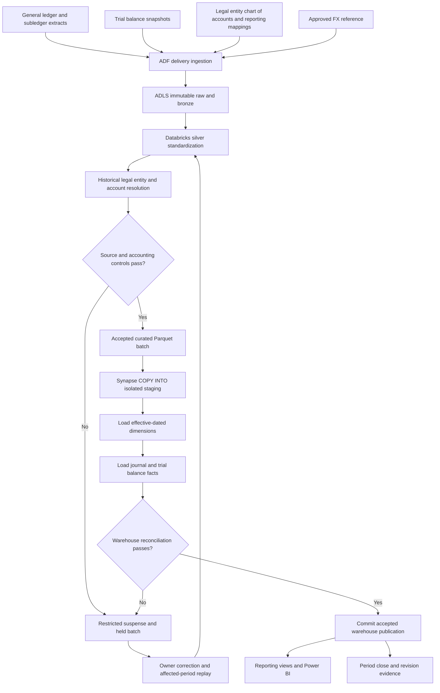
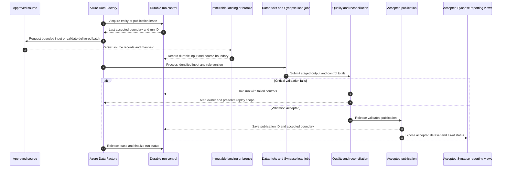
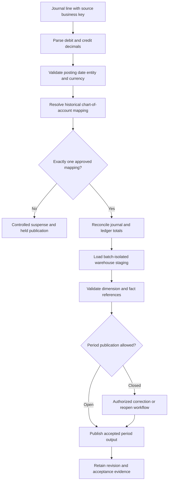
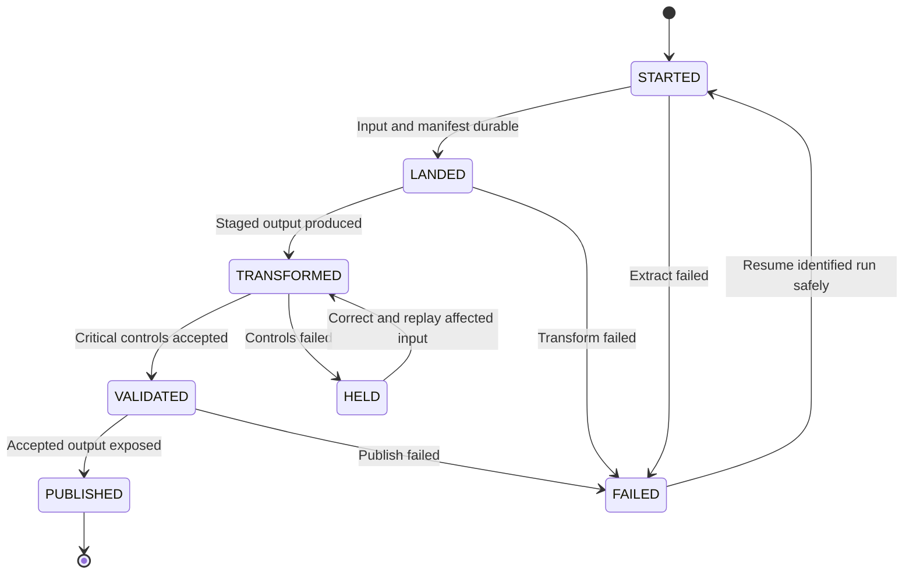
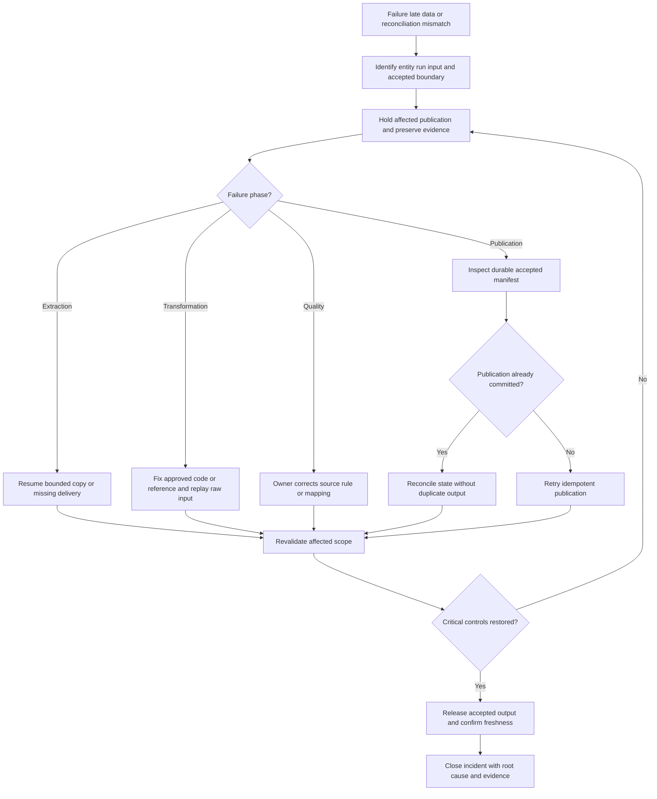
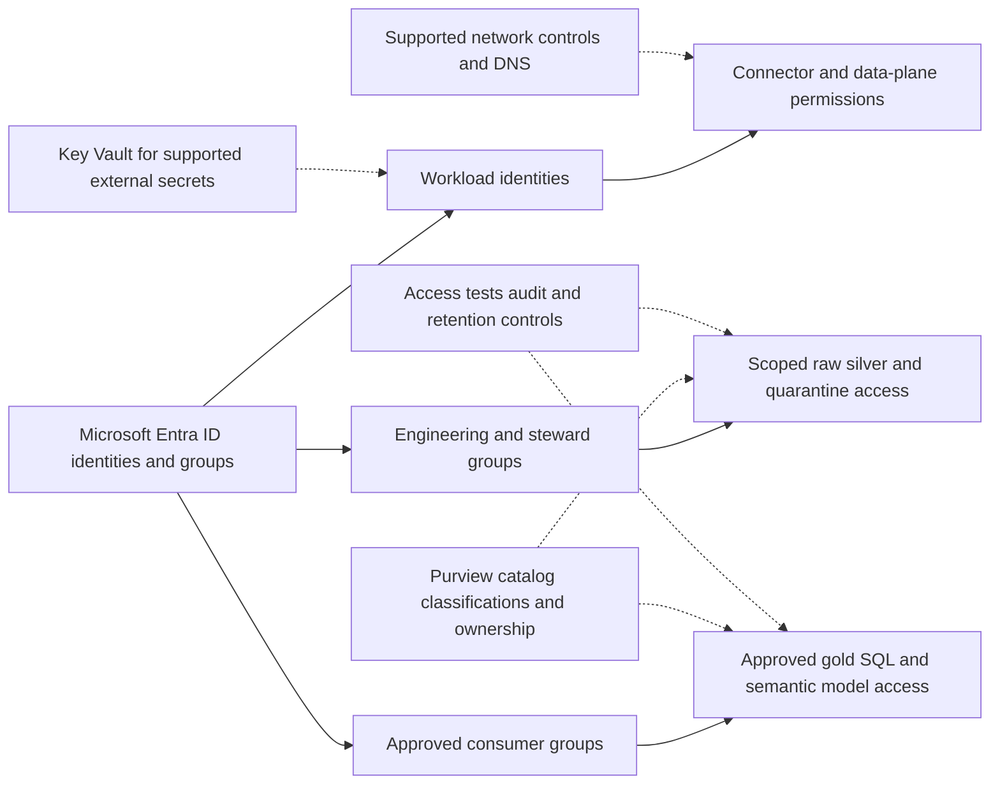
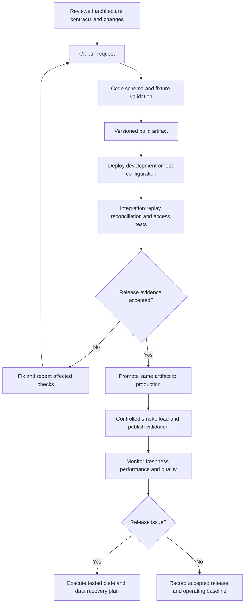

# Barclays (RFTBSL & SRP): Financial Data Warehouse Integration

> Evidence status: the client and project labels were supplied by the user. Architecture, datasets, responsibilities and implementation below are proposed reference designs for preparation. They are not verified descriptions of a client's internal platform. Replace illustrative details with actual experience before using them as employment claims.

## Project profile

- Target role: Azure Data Engineer / Financial ETL Developer.
- Employer: [actual employer]; client engagement dates: [MM YYYY–MM YYYY].
- Contribution: [what you personally designed/built/operated]; team: [verified size and roles].
- Scale: [verified daily volume, entity count and historical size].
- Outcomes: [baseline, measured result, period and measurement method].

## Business objective

Integrate financial subledger, journal, reference, and reporting feeds into a reconciled dimensional warehouse with historical traceability.

## Azure and Microsoft technology stack

Azure Data Factory, ADLS Gen2, Azure Databricks for complex transformations, Azure Synapse Analytics dedicated SQL pool for dimensional serving, Azure SQL Database for pipeline metadata, Azure Key Vault, Microsoft Entra ID, Microsoft Purview, Azure Monitor, Azure DevOps, Power BI.

Illustrative sources: journal lines, trial-balance extracts, subledger balances, legal-entity hierarchy, chart of accounts, reporting mappings and FX rates. Preserve RFTBSL/SRP as supplied labels until their internal definitions are confirmed.

## End-to-end architecture

```text
Subledgers / GL / reporting feeds --> ADF --> ADLS raw --> Databricks standardized Delta --> immutable curated Parquet batch --> Synapse staging --> dimensions/facts --> reporting views / Power BI
Cross-cutting: identity + access | quality + reconciliation | metadata + lineage | CI/CD + monitoring
```

The source owner provides bounded, identifiable deliveries. Engineering preserves raw input, applies explicit business rules, validates the result and releases only an accepted dataset. Consumers receive a defined product with an owner and freshness contract.

## Data model

| Dataset | Grain | Example columns |
|---|---|---|
| dim_legal_entity | One legal entity version per effective interval | legal_entity_sk, entity_code, parent_code, valid_from, valid_to |
| dim_gl_account | One account/mapping version per effective interval | gl_account_sk, account_code, reporting_line, valid_from, valid_to |
| fact_journal_line | One source journal line | source_system, journal_id, line_id, posting_date, debit_amount, credit_amount, currency_code |
| fact_trial_balance | One entity/account/currency/period snapshot | entity_sk, gl_account_sk, period_key, currency_code, debit_total, credit_total |
| reconciliation_control | One financial control per load | run_id, source_system, entity_code, period_key, control_name, difference, status |

All names and columns are illustrative. Confirm uniqueness, source precedence, null handling, timezones, history policy and retention before implementing physical tables. A snapshot fact and an event fact require different aggregation rules.

## Technical implementation

### 1. Agree accounting and reporting rules

Define signed debit/credit convention, chart-of-account mappings, legal-entity hierarchy, fiscal periods, adjustment handling, FX policies and journal line keys. Reporting labels do not establish these rules automatically.

### 2. Land and validate extracts

Use ADF for immutable bounded batches; record file manifests and source control totals. Reject incomplete deliveries and unsupported schemas before transformation.

### 3. Standardize and reconcile

Use Databricks to parse decimal amounts, normalize codes and preserve source line identifiers. Validate debit/credit balancing at the agreed scope and compare subledger versus GL totals without hiding unexplained differences.

### 4. Load effective-dated dimensions

Maintain stable surrogate keys and nonoverlapping validity intervals. Resolve journal facts against dimension versions effective on the posting date. Put unknown mappings into a controlled suspense process.

### 5. Load warehouse staging

Export the accepted Delta batch as curated Parquet to ADLS and use a supported Synapse load path such as COPY INTO. Load batch-isolated staging, validate keys, then use a dedicated-pool-supported set-based publish transaction.

### 6. Publish finance facts

Load dimensions before facts, validate reconciliation, then commit the accepted batch. Use tested insert/update/delete patterns compatible with the chosen Synapse release; do not assume Databricks Delta MERGE syntax works in the SQL pool.

### 7. Serve and close periods

Create reporting views with explicit amount and period definitions, publish semantic models, and record a close-state/version for approved periods. Reopen and republish historical periods only through the agreed approval workflow.

## Project-specific SQL example

The snippet illustrates one transformation/control, not an executable project by itself. Create the referenced tables, bind parameters using the selected runtime's supported API, and validate input contracts first.

```sql
-- Azure Databricks Spark SQL: transaction-currency journal control.
SELECT source_system, legal_entity_code, journal_id, currency_code,
       SUM(CAST(debit_amount AS DECIMAL(28, 6))) AS total_debit,
       SUM(CAST(credit_amount AS DECIMAL(28, 6))) AS total_credit,
       SUM(CAST(debit_amount AS DECIMAL(28, 6)))
         - SUM(CAST(credit_amount AS DECIMAL(28, 6))) AS difference
FROM silver.journal_line
WHERE run_id = :run_id
GROUP BY source_system, legal_entity_code, journal_id, currency_code;
-- Apply the agreed balancing scope and rounding tolerance;
-- some journal contracts require a different balancing scope.
```

## Validation and acceptance

- Validate uniqueness at source system + journal ID + line ID and prove reversals remain linked to original entries.
- Reconcile source-to-stage-to-fact counts and amounts by legal entity, currency, period and source.
- Test changes to historical account mappings and demonstrate correct as-of dimension resolution.
- Check dimensional load atomicity and distribution skew under representative fact volume.
- Replay the same accepted input twice and verify the business output is unchanged.
- Obtain approval from the business owner using source/control evidence before consumer cutover.

## Failure and recovery example

A corrected journal arrives after a reporting period is closed. Retain it in landing and flag the impacted period. Follow the authorized reopen/correction policy, resolve historical mappings, rerun balancing and source controls, then publish a traceable reporting revision.

Do not advance accepted source state when extraction, validation or publication fails. Resume from durable input and the last accepted boundary; do not resolve data differences by blindly rerunning downstream reports.

## Architecture tradeoff to explain in interviews

Synapse dedicated SQL pool is useful for warehouse-style serving but needs distribution, load and workload tuning. Use measured high-cardinality join keys for large fact distribution and replicate only suitably small dimensions. Lakehouse and warehouse add separate copies and reconciliation points.

## Deployment and production ownership

- Keep development, test, and production resources and identities separate. Provision Azure resources through reviewed Bicep/Terraform and deploy notebooks, SQL, configuration, and pipeline definitions through Azure DevOps.
- Run schema/contract checks and transformation tests on synthetic or approved masked data, followed by integration validation in test. Promote the same reviewed artifact with environment-specific parameters.
- Store supported secrets in Azure Key Vault; prefer managed identity or approved workload identity wherever the connector supports it. Do not embed secrets in notebooks or Markdown.
- Version contracts, business rules and published schemas. Take a recovery point before a destructive schema migration; validate both application rollback and data rollback.
- Record run ID, entity, source boundary, input/output counts, reconciliation result, quality status, execution time and publication ID. Monitor freshness separately from job success.
- Agree actual freshness target, RPO, RTO, support owner and escalation route before go-live. Targets in an interview must be verified, not invented.

## Security implementation

Use Microsoft Entra ID groups and least-privilege workload identities. Apply ADLS RBAC and ACLs, Databricks Unity Catalog grants or Fabric workload/OneLake permissions as appropriate. Limit storage network access through supported private networking, firewalls and validated DNS configuration. Review Fabric connectivity separately; Azure Private Link assumptions do not automatically apply to every Fabric workload. Restrict raw and quarantine zones, mask sensitive attributes in test and consumer datasets, and keep personal data out of logs. Configure Power BI access and row-level security independently of direct data access. Agree residency, retention and deletion requirements with the data owner rather than claiming a platform configuration guarantees compliance.

## Implementation deliverables and release evidence

1. Source inventory, data contract, sample input and expected output.
2. Architecture and identity/connectivity design approved for the environment.
3. Pipeline definitions, notebooks, SQL transformations and configuration metadata.
4. Model dictionary with grain, keys, decimal precision and historical behavior.
5. Test fixtures/results, source reconciliation and signed acceptance record.
6. CI/CD definition, infrastructure code, rollback procedure and cost baseline.
7. Lineage documentation, ownership/access matrix, operating dashboard and runbook.

These documents describe the implementation; they are not a deployed platform or evidence of work performed for the named client. Use the shared implementation handbook for code patterns, an executable build sequence, recovery handling and acceptance templates.


## Interview walkthrough

Use this sequence with your actual details: explain the business requirement; identify sources and their grain; draw the end-to-end flow; explain your personal contribution; describe one transformation and one control; walk through a failure/recovery; explain a measured optimization and its tradeoff; state the accepted result.

Practice these questions:

1. Why were these Azure services selected, and what alternative did you evaluate?
2. How were inserts, updates, deletes, duplicates and late data handled?
3. What proved the published data was complete and financially/operationally correct?
4. How did you prevent exposure through raw files, SQL, BI and exception logs?
5. How did you deploy, roll back, replay and recover the platform?
6. Which parts did you personally implement, and what evidence supports the claimed impact?

## Resume-ready project bullets — use only if verified

- Integrated [verified finance feeds] using ADF, ADLS Gen2, Azure Databricks, and Synapse Analytics.
- Developed dimensional models, historical account mappings, and journal/trial-balance facts.
- Implemented financial reconciliation and controlled period-based publication for [verified reporting scope].
- Optimized [verified warehouse load/query] from [baseline] to [result] using [measured tuning change].

## Technical references

The following official references support the platform patterns, not the named client's implementation.

- [Fabric medallion lakehouse architecture](https://learn.microsoft.com/en-us/fabric/onelake/onelake-medallion-lakehouse-architecture)
- [Fabric end-to-end lakehouse tutorial](https://learn.microsoft.com/en-us/fabric/data-engineering/tutorial-lakehouse-introduction)
- [ADF incremental ingestion with watermarks](https://learn.microsoft.com/en-us/azure/data-factory/tutorial-incremental-copy-portal)
- [Azure Databricks MERGE reference](https://learn.microsoft.com/en-us/azure/databricks/sql/language-manual/delta-merge-into)
- [Azure Databricks change data feed](https://learn.microsoft.com/en-us/azure/databricks/delta/delta-change-data-feed)
- [Microsoft Purview governance setup](https://learn.microsoft.com/en-us/purview/data-governance-get-started)

<!-- EXPANDED_FLOW_START -->

## Full flow diagrams and detailed execution narrative

The following diagrams expand the entire reference project lifecycle. Solid arrows indicate the stated data or workflow direction; dotted arrows indicate supporting configuration, catalog or security relationships. These are proposed designs and must be checked against the actual engagement.

### Diagram 1: Complete project data flow




**How to read the diagram:** start with the source groups, follow ingestion into durable raw/bronze data, then follow validated transformations into the accepted serving dataset. The rejection paths are part of the production flow: a held run retains its input and evidence so the owner can investigate and engineering can replay the affected scope. Raw inputs, staged output and accepted publications are different artifacts.

### Source-to-output contracts

| Input group | Business grain | Ingestion contract | Result |
|---|---|---|---|
| Journal lines | Source + journal ID + line ID | Approved ledger delivery/change feed | Financial line-level fact |
| Legal entity and GL dimensions | Business key + effective interval | Versioned reference changes | Historical reporting mapping |
| Trial balance | Entity + account + currency + period | Authoritative period snapshot | Period totals under agreed sign convention |
| Reconciliation controls | Run + entity + period + control | Source/stage/fact validation | Accepted warehouse and close evidence |

For every input, confirm the owner, business key, event/effective timestamp, source change sequence, extraction boundary, deletion semantics and reference dependencies. Choose snapshot, watermark, CDC or event ingestion from those semantics. Do not assume a file delivery is complete merely because the file is readable.

### Diagram 2: Runtime interaction from source to consumer




This sequence describes an accepted batch or publication cycle. For streaming, raw events are persisted continuously and product publication follows the chosen microbatch/date policy; an ADF schedule is not required for every event. The control store holds durable state, while the accepted publication records the actual output exposed to consumers. Where these sit in different systems, recovery reconciles their manifests instead of assuming a shared atomic transaction.

### Detailed stage explanations

### Stage 1: Agree accounting and reporting rules

Define signed debit/credit convention, chart-of-account mappings, legal-entity hierarchy, fiscal periods, adjustment handling, FX policies and journal line keys. Reporting labels do not establish these rules automatically.

**Execution evidence:** record the input scope, source/run boundary, applicable contract or rule version, produced artifact and acceptance status for this stage. The next dependent stage consumes its accepted output; an execution timestamp alone is insufficient evidence of correctness.

### Stage 2: Land and validate extracts

Use ADF for immutable bounded batches; record file manifests and source control totals. Reject incomplete deliveries and unsupported schemas before transformation.

**Execution evidence:** record the input scope, source/run boundary, applicable contract or rule version, produced artifact and acceptance status for this stage. The next dependent stage consumes its accepted output; an execution timestamp alone is insufficient evidence of correctness.

### Stage 3: Standardize and reconcile

Use Databricks to parse decimal amounts, normalize codes and preserve source line identifiers. Validate debit/credit balancing at the agreed scope and compare subledger versus GL totals without hiding unexplained differences.

**Execution evidence:** record the input scope, source/run boundary, applicable contract or rule version, produced artifact and acceptance status for this stage. The next dependent stage consumes its accepted output; an execution timestamp alone is insufficient evidence of correctness.

### Stage 4: Load effective-dated dimensions

Maintain stable surrogate keys and nonoverlapping validity intervals. Resolve journal facts against dimension versions effective on the posting date. Put unknown mappings into a controlled suspense process.

**Execution evidence:** record the input scope, source/run boundary, applicable contract or rule version, produced artifact and acceptance status for this stage. The next dependent stage consumes its accepted output; an execution timestamp alone is insufficient evidence of correctness.

### Stage 5: Load warehouse staging

Export the accepted Delta batch as curated Parquet to ADLS and use a supported Synapse load path such as COPY INTO. Load batch-isolated staging, validate keys, then use a dedicated-pool-supported set-based publish transaction.

**Execution evidence:** record the input scope, source/run boundary, applicable contract or rule version, produced artifact and acceptance status for this stage. The next dependent stage consumes its accepted output; an execution timestamp alone is insufficient evidence of correctness.

### Stage 6: Publish finance facts

Load dimensions before facts, validate reconciliation, then commit the accepted batch. Use tested insert/update/delete patterns compatible with the chosen Synapse release; do not assume Databricks Delta MERGE syntax works in the SQL pool.

**Execution evidence:** record the input scope, source/run boundary, applicable contract or rule version, produced artifact and acceptance status for this stage. The next dependent stage consumes its accepted output; an execution timestamp alone is insufficient evidence of correctness.

### Stage 7: Serve and close periods

Create reporting views with explicit amount and period definitions, publish semantic models, and record a close-state/version for approved periods. Reopen and republish historical periods only through the agreed approval workflow.

**Execution evidence:** record the input scope, source/run boundary, applicable contract or rule version, produced artifact and acceptance status for this stage. The next dependent stage consumes its accepted output; an execution timestamp alone is insufficient evidence of correctness.

### Diagram 3: Project-specific business transformation




**Business meaning:** Integrate financial subledger, journal, reference, and reporting feeds into a reconciled dimensional warehouse with historical traceability. The diagram highlights where the project-specific rules alter the data's meaning, grain or reporting status. Technical success at these stages does not substitute for the business control evidence described below.

### Worked record journey

An illustrative journal has a debit of GBP 100.00 to one account and a credit of GBP 100.00 to another account. Both source lines retain their source system, journal ID and line ID. The control verifies balancing at the scope agreed with the ledger owner; it does not mix currencies or silently round away a discrepancy.

The posting date resolves the historical legal-entity and chart-of-account versions. If an account is remapped to a reporting line later, the original journal uses the mapping effective for its posting date unless a separately approved restatement policy says otherwise. The transformation exports only an accepted batch to Parquet for warehouse loading.

Synapse staging is isolated by batch so another run cannot overwrite inputs during publication. The fact load is validated before acceptance. A correction to a closed period follows the period correction/reopen workflow and creates traceable reporting revision evidence. Trial balances are snapshots at entity/account/currency/period grain; their reporting aggregation must follow the accounting contract rather than indiscriminately summing periods.

The example is synthetic and demonstrates behavior, not actual client data or a measured client outcome. Trace a record using its source business key, source sequence, raw location, run ID, contract/rule version and accepted publication ID. Avoid putting sensitive payload values in general logs.

### Dependencies, scheduling and publication boundaries

Reference and effective-dated dimensions must be available before journal fact key resolution. Accepted lake transformations precede Parquet export and Synapse staging. Warehouse reconciliation and period-state approval precede consumer publication.

Keep a dependency manifest for each publication. It should identify the accepted source/reference versions, transformed partition scope and resulting output version. A successful upstream run is usable only if its controls passed and its artifact matches the downstream contract. Run independent entities concurrently only within the approved resource/source limits; serialize publication where concurrent writers could conflict.

**Suggested parameter contract:** `entity_id`, `run_id`, `business_date` or bounded change range, `contract_version`, `rule_version`, `input_manifest_uri`, `output_stage_uri`, `environment`, and `replay_mode`. Validate values and allow-list identifiers. Use the same input/rule scope during a replay unless the run explicitly records an approved correction.

### Diagram 4: Lifecycle and acceptance states




`STARTED` means a run exists; `LANDED` means its inputs are durable; `TRANSFORMED` means a candidate output exists; `VALIDATED` means the critical checks passed; `PUBLISHED` means consumers can read the accepted output. `HELD` indicates a deliberate business/control stop and `FAILED` indicates an execution failure. Extend the handbook's minimal control-table status constraint if you implement these additional states. The diagram is a recommended lifecycle, not a claim that the existing example DDL already includes every state.

Track state transitions with timestamps, actor/workload identity, reason and artifact IDs. A retry is an attempt tied to the original business input. Replaying a publication should not create extra fact rows, duplicate daily aggregates or misleading extra accepted runs.

### Diagram 5: Error handling, late correction and recovery




**Project recovery scenario:** A corrected journal arrives after a reporting period is closed. Retain it in landing and flag the impacted period. Follow the authorized reopen/correction policy, resolve historical mappings, rerun balancing and source controls, then publish a traceable reporting revision.

Before retrying, determine whether the failure occurred before or after publication. A run can publish successfully and fail while recording its state; a blind repeat can double-count outputs. Inspect the accepted manifest, compare expected key/count/control evidence, and complete or roll back the recorded state safely. Missing or corrupt inputs require source correction; transformation fixes require versioned code; business-control failures require the relevant owner's resolution.

For a late correction, identify affected event dates, historical dimension intervals and dependent aggregate/reporting periods. Recompute the smallest complete business scope rather than updating only an arbitrary file. Preserve old publication metadata and make consumer as-of/revision information clear.

### Diagram 6: Identity, access and governance flow




Permissions are enforced at the workload, storage/catalog and serving layers used by this project. The catalog documents ownership and classification; permissions still need implementation and testing. Validate engineer, workload, steward and consumer paths independently, including raw, quarantine, direct SQL and dashboard exports. A masked dashboard does not justify unrestricted raw access.

Use approved identities for source connections and pipeline execution. Key Vault applies to supported external-secret scenarios; configure Fabric connection credentials through supported mechanisms rather than assuming Azure managed identity works identically for every connector. Network restrictions, retention and residency settings are environment-specific controls to verify during deployment.

### Diagram 7: Development-to-production deployment flow




Create source contracts, physical schemas and fixtures before building the complete pipeline. Deploy infrastructure and configuration first, then compatible tables and transformations, then orchestration and serving objects. Test one vertical slice before adding volume or source variants. Promote reviewed artifacts with separate environment parameters and identities. Confirm the selected Azure/Fabric item's deployment support instead of assuming every object uses the same release mechanism.

Production smoke validation checks source reachability, identity permissions, small bounded processing, accepted publication and consumer reads. If a release changes stored data/schema, the rollback plan must cover those data changes as well as code. Record who owns the decision and where the recovery evidence is stored.

### Consumer request and reporting behavior

Finance users read approved warehouse views and semantic models with explicit period, legal-entity, currency and revision filters. A warehouse read path must expose the accepted reporting state, not staging tables or an incomplete period load.

Every product should expose its grain, accepted as-of boundary, revision/contract version, freshness status, business owner and access route. Serving queries should select accepted output; do not expose unvalidated staging by accident. If multiple datasets publish independently, the report must handle and display their differing as-of dates.

### Observability from ingestion through consumption

| Layer | What to record or measure | What the signal establishes |
|---|---|---|
| Source/landing | Boundary, delivery IDs, source counts, manifests, completeness | Whether all expected input arrived |
| Transformation | Rule/code version, input/output scope, rejected rows, duration | Which logic ran on which records |
| Validation | Key coverage, decimal totals, rule results, accepted status | Whether the output meets its contract |
| Publication | Dataset version, accepted boundary, publication ID | Exactly what consumers can read |
| Consumption | Access-test outcomes, serving errors, query latency | Whether authorized users can use the product |
| Recovery | Failed phase, replay input, replacement publication, controls | Whether service was restored correctly |

Measure extraction, Databricks transformation, Parquet export, warehouse load and reporting queries separately. Choose warehouse distribution based on actual join/filter patterns and skew; verify batch loads and update patterns against the selected Synapse engine.

Alert on accepted-data age as well as job failure. A pipeline can finish successfully while a source feed is stale or the product remains held. Dashboard a last accepted timestamp and business freshness target, and route each alert to its actual owning team.

### Project-specific completion and interview evidence

- Validate uniqueness at source system + journal ID + line ID and prove reversals remain linked to original entries.
- Reconcile source-to-stage-to-fact counts and amounts by legal entity, currency, period and source.
- Test changes to historical account mappings and demonstrate correct as-of dimension resolution.
- Check dimensional load atomicity and distribution skew under representative fact volume.
- Demonstrate normal flow, rejected flow, duplicate replay and a late correction using synthetic/approved fixtures.
- Verify the diagram against deployed resources, connections, code and actual publication artifacts.
- Keep one accepted-run evidence packet linking manifest, controls, serving dataset and consumer acceptance.
- Replace illustrative names, example dates, sources and targets with verified engagement details before discussing them as past experience.

**Interview explanation:** draw Diagram 1, describe the worked record journey, identify your own implemented stages, explain Diagram 3's business rules, show how the critical gate protects publication, then use Diagram 5 to explain a concrete recovery. Finish with the verified output and a measured result supported by evidence.

### Plain-text fallback flow

Some Markdown viewers do not render Mermaid. The original architecture section and the following text retain the core flow in those viewers:

```text
Subledgers / GL / reporting feeds --> ADF --> ADLS raw --> Databricks standardized Delta --> immutable curated Parquet batch --> Synapse staging --> dimensions/facts --> reporting views / Power BI
1. Confirm source contract and accepted dependencies.
2. Persist identifiable raw input and manifest.
3. Apply ordered, versioned business transformations.
4. Validate critical rules and source-to-target controls.
5. On failure: hold -> investigate -> correct -> replay -> revalidate.
6. On acceptance: publish -> record accepted boundary -> expose to consumers.
7. Monitor freshness, correctness, access, performance and recovery.
```
