# Mobistar: Telecom Data Warehouse Transformation

**Single-file project document:** architecture, all 12 flow diagrams, technical notes, examples, controls, deployment and recovery guidance are included in this Markdown file. No separate diagram assets or handbook are required.

> Evidence status: the client and project labels were supplied by the user. Architecture, datasets, responsibilities and implementation below are proposed reference designs for preparation. They are not verified descriptions of a client's internal platform. Replace illustrative details with actual experience before using them as employment claims.

## Project profile

- Target role: Azure Data Engineer / Telecom Data Engineer.
- Employer: [actual employer]; client engagement dates: [MM YYYY–MM YYYY].
- Contribution: [what you personally designed/built/operated]; team: [verified size and roles].
- Scale: [verified daily volume, entity count and historical size].
- Outcomes: [baseline, measured result, period and measurement method].

## Business objective

Transform high-volume telecom usage and subscriber/billing feeds into reliable analytical facts for usage, billing comparison, and network/service performance.

## Azure and Microsoft technology stack

Azure Event Hubs for event ingestion where justified, Azure Data Factory for batch feeds, ADLS Gen2, Azure Databricks Structured Streaming and Delta Lake, Databricks SQL, Azure Key Vault, Microsoft Entra ID, Microsoft Purview, Azure Monitor/Log Analytics, Azure DevOps, Power BI.

Illustrative sources: call-detail records (CDRs), data-session events, subscriber/account master, tariff versions, cell/site reference, and billing extracts. A modern Azure redesign does not imply Azure was used during any historical Mobistar engagement.

## End-to-end architecture

```text
CDR/session producers --> Event Hubs --> Databricks checkpointed stream --> bronze Delta; billing/subscriber files --> ADF --> ADLS --> bronze; bronze --> silver usage + dimensions --> gold daily facts --> Databricks SQL / Power BI
Cross-cutting: identity + access | quality + reconciliation | metadata + lineage | CI/CD + monitoring
```

The source owner provides bounded, identifiable deliveries. Engineering preserves raw input, applies explicit business rules, validates the result and releases only an accepted dataset. Consumers receive a defined product with an owner and freshness contract.

## Data model

| Dataset | Grain | Example columns |
|---|---|---|
| fact_usage_event | One immutable source usage event | source_system, event_id, subscriber_id, event_ts, service_type, duration_sec, bytes_used, cell_id |
| dim_subscriber | One subscriber version per effective interval | subscriber_sk, subscriber_id, plan_id, status, valid_from, valid_to |
| dim_tariff | One tariff version per effective interval | tariff_sk, plan_id, unit_type, unit_rate, valid_from, valid_to |
| fact_daily_usage | One subscriber/service/date aggregation | subscriber_sk, usage_date, service_type, event_count, duration_sec, bytes_used |
| billing_comparison | One account/service/billing-period comparison | account_id, billing_period, expected_charge, billed_charge, difference |

All names and columns are illustrative. Confirm uniqueness, source precedence, null handling, timezones, history policy and retention before implementing physical tables. A snapshot fact and an event fact require different aggregation rules.

## Technical implementation

### 1. Define event semantics

Specify a globally stable source event key, event timestamp timezone, duration/volume units, producer sequence, correction semantics and privacy policy for subscriber/location identifiers.

### 2. Build dual ingestion paths

Write Event Hubs events to bronze with source envelope metadata and durable checkpoints. Use ADF for billing and reference files, with delivery manifests and bounded extraction. Partitioning strategy follows measured throughput and query needs.

### 3. Parse and validate usage

Use explicit schemas; quarantine invalid payloads and impossible units according to contract. Retain raw timestamps and normalize to UTC. Ensure masked identifiers remain joinable only through approved controlled mappings.

### 4. Handle duplication and late events

Apply a stated event-time watermark for bounded streaming deduplication. Keep durable event keys and a reconciliation/backfill process for arrivals outside the streaming horizon; watermarking alone does not eliminate every future replay.

### 5. Enrich historical context

Resolve subscriber and tariff versions using event time. Determine expected usage charges only from approved tariff rules, including rounding, bundles and promotions. Avoid treating duration multiplied by unit rate as a complete billing engine.

### 6. Build usage and billing products

Aggregate accepted events by usage date, subscriber and service. Rebuild affected dates for late corrections; compare approved expected charges with billing extracts at the agreed account/period scope.

### 7. Operate streaming and serving

Monitor input rate, processing latency, checkpoint health and event lag. Scale based on measured bottlenecks. Publish governed SQL datasets and dashboards; explicitly handle expired Event Hubs retention through retained bronze/archive data.

## Project-specific SQL example

The snippet illustrates one transformation/control, not an executable project by itself. Create the referenced tables, bind parameters using the selected runtime's supported API, and validate input contracts first.

```sql
-- Spark SQL on accepted silver usage, using UTC dates in this example.
SELECT subscriber_id, CAST(event_ts AS DATE) AS usage_date, service_type,
       COUNT(*) AS event_count,
       SUM(CAST(duration_sec AS BIGINT)) AS duration_sec,
       SUM(CAST(bytes_used AS BIGINT)) AS bytes_used
FROM silver.usage_event
WHERE CAST(event_ts AS DATE) = :affected_date
GROUP BY subscriber_id, CAST(event_ts AS DATE), service_type;
-- Rebuild and replace the affected gold date only after checks pass;
-- do not append a second aggregate for the same business key.
```

## Validation and acceptance

- Replay duplicate events both inside and outside the watermark horizon; prove durable publication does not double count.
- Test out-of-order events, malformed timestamps, plan changes at midnight and tariff version overlaps.
- Compare aggregate duration/bytes/counts with source controls using compatible units and dates.
- Simulate checkpoint recovery and a source outage longer than broker retention using a retained archive.
- Replay the same accepted input twice and verify the business output is unchanged.
- Obtain approval from the business owner using source/control evidence before consumer cutover.

## Failure and recovery example

A stream restarts and replays an older CDR batch. Reuse its durable checkpoint where valid, deduplicate against stable event keys, reconcile the impacted days, and rebuild those gold dates. If offsets expired, recover from retained raw data rather than assuming Event Hubs still contains the events.

Do not advance accepted source state when extraction, validation or publication fails. Resume from durable input and the last accepted boundary; do not resolve data differences by blindly rerunning downstream reports.

## Architecture tradeoff to explain in interviews

Streaming improves freshness but introduces state, checkpoints, late-event policy and ongoing compute cost. Use batch for feeds whose freshness contract permits it. Separate operational event latency from the completeness of billing-period data.

## Deployment and production ownership

- Keep development, test, and production resources and identities separate. Provision Azure resources through reviewed Bicep/Terraform and deploy notebooks, SQL, configuration, and pipeline definitions through Azure DevOps.
- Run schema/contract checks and transformation tests on synthetic or approved masked data, followed by integration validation in test. Promote the same reviewed artifact with environment-specific parameters.
- Store supported secrets in Azure Key Vault; prefer managed identity or approved workload identity wherever the connector supports it. Do not embed secrets in notebooks or Markdown.
- Version contracts, business rules and published schemas. Take a recovery point before a destructive schema migration; validate both application rollback and data rollback.
- Record run ID, entity, source boundary, input/output counts, reconciliation result, quality status, execution time and publication ID. Monitor freshness separately from job success.
- Agree actual freshness target, RPO, RTO, support owner and escalation route before go-live. Targets in an interview must be verified, not invented.

## Security implementation

Use Microsoft Entra ID groups and least-privilege workload identities. Apply ADLS RBAC and ACLs, Databricks Unity Catalog grants or Fabric workload/OneLake permissions as appropriate. Limit storage network access through supported private networking, firewalls and validated DNS configuration. Review Fabric connectivity separately; Azure Private Link assumptions do not automatically apply to every Fabric workload. Restrict raw and quarantine zones, mask sensitive attributes in test and consumer datasets, and keep personal data out of logs. Configure Power BI access and row-level security independently of direct data access. Agree residency, retention and deletion requirements with the data owner rather than claiming a platform configuration guarantees compliance.

## Implementation deliverables and release evidence

1. Source inventory, data contract, sample input and expected output.
2. Architecture and identity/connectivity design approved for the environment.
3. Pipeline definitions, notebooks, SQL transformations and configuration metadata.
4. Model dictionary with grain, keys, decimal precision and historical behavior.
5. Test fixtures/results, source reconciliation and signed acceptance record.
6. CI/CD definition, infrastructure code, rollback procedure and cost baseline.
7. Lineage documentation, ownership/access matrix, operating dashboard and runbook.

These documents describe the implementation; they are not a deployed platform or evidence of work performed for the named client. The implementation reference at the end of this file provides code patterns, a build sequence, recovery handling and acceptance templates.


## Interview walkthrough

Use this sequence with your actual details: explain the business requirement; identify sources and their grain; draw the end-to-end flow; explain your personal contribution; describe one transformation and one control; walk through a failure/recovery; explain a measured optimization and its tradeoff; state the accepted result.

Practice these questions:

1. Why were these Azure services selected, and what alternative did you evaluate?
2. How were inserts, updates, deletes, duplicates and late data handled?
3. What proved the published data was complete and financially/operationally correct?
4. How did you prevent exposure through raw files, SQL, BI and exception logs?
5. How did you deploy, roll back, replay and recover the platform?
6. Which parts did you personally implement, and what evidence supports the claimed impact?

## Resume-ready project bullets — use only if verified

- Developed Azure batch and [if verified] streaming pipelines for telecom usage, subscriber, and billing datasets.
- Implemented CDR parsing, durable event deduplication, late-event handling, and historical subscriber enrichment.
- Created daily usage facts and billing-comparison datasets using Azure Databricks and Delta Lake.
- Improved [measured freshness/processing metric] from [baseline] to [result] across [verified volume].

## Technical references

The following official references support the platform patterns, not the named client's implementation.

- [Fabric medallion lakehouse architecture](https://learn.microsoft.com/en-us/fabric/onelake/onelake-medallion-lakehouse-architecture)
- [Fabric end-to-end lakehouse tutorial](https://learn.microsoft.com/en-us/fabric/data-engineering/tutorial-lakehouse-introduction)
- [ADF incremental ingestion with watermarks](https://learn.microsoft.com/en-us/azure/data-factory/tutorial-incremental-copy-portal)
- [Azure Databricks MERGE reference](https://learn.microsoft.com/en-us/azure/databricks/sql/language-manual/delta-merge-into)
- [Azure Databricks change data feed](https://learn.microsoft.com/en-us/azure/databricks/delta/delta-change-data-feed)
- [Microsoft Purview governance setup](https://learn.microsoft.com/en-us/purview/data-governance-get-started)

<!-- EXPANDED_FLOW_START -->

## Full flow diagrams and detailed execution narrative

The following diagrams expand the entire reference project lifecycle. Solid arrows indicate the stated data or workflow direction; dotted arrows indicate supporting configuration, catalog or security relationships. These are proposed designs and must be checked against the actual engagement.

### Diagram 1: Complete project data flow

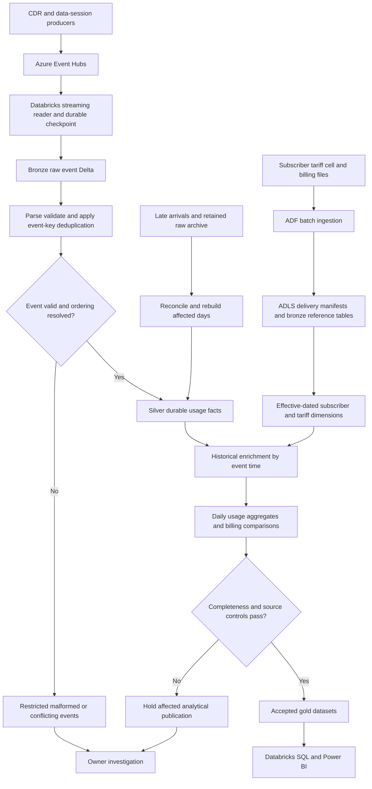


**How to read the diagram:** start with the source groups, follow ingestion into durable raw/bronze data, then follow validated transformations into the accepted serving dataset. The rejection paths are part of the production flow: a held run retains its input and evidence so the owner can investigate and engineering can replay the affected scope. Raw inputs, staged output and accepted publications are different artifacts.

### Source-to-output contracts

| Input group | Business grain | Ingestion contract | Result |
|---|---|---|---|
| Usage/CDR events | Source system + event ID | Checkpointed events and approved replay | Durable usage facts with corrected event semantics |
| Subscriber/tariff versions | Source key + effective interval | ADF reference delivery | Historical plan and tariff enrichment |
| Daily usage | Subscriber + service + usage date | Rebuild affected date from silver | Count/duration/volume totals |
| Billing comparison | Account + service + billing period | Approved rating and billing extracts | Traceable expected-vs-billed comparison |

For every input, confirm the owner, business key, event/effective timestamp, source change sequence, extraction boundary, deletion semantics and reference dependencies. Choose snapshot, watermark, CDC or event ingestion from those semantics. Do not assume a file delivery is complete merely because the file is readable.

### Diagram 2: Runtime interaction from source to consumer

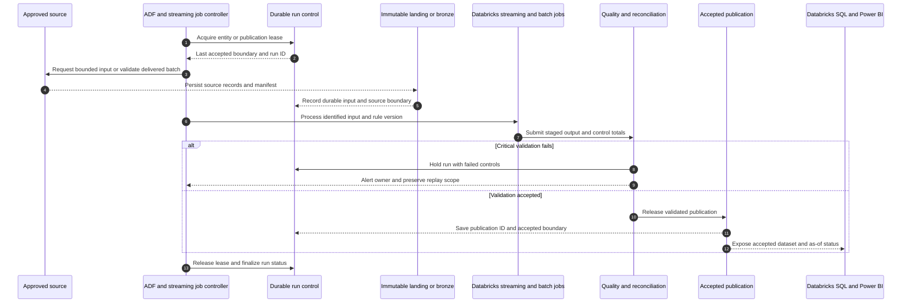


This sequence describes an accepted batch or publication cycle. For streaming, raw events are persisted continuously and product publication follows the chosen microbatch/date policy; an ADF schedule is not required for every event. The control store holds durable state, while the accepted publication records the actual output exposed to consumers. Where these sit in different systems, recovery reconciles their manifests instead of assuming a shared atomic transaction.

### Detailed stage explanations

### Stage 1: Define event semantics

Specify a globally stable source event key, event timestamp timezone, duration/volume units, producer sequence, correction semantics and privacy policy for subscriber/location identifiers.

**Execution evidence:** record the input scope, source/run boundary, applicable contract or rule version, produced artifact and acceptance status for this stage. The next dependent stage consumes its accepted output; an execution timestamp alone is insufficient evidence of correctness.

### Stage 2: Build dual ingestion paths

Write Event Hubs events to bronze with source envelope metadata and durable checkpoints. Use ADF for billing and reference files, with delivery manifests and bounded extraction. Partitioning strategy follows measured throughput and query needs.

**Execution evidence:** record the input scope, source/run boundary, applicable contract or rule version, produced artifact and acceptance status for this stage. The next dependent stage consumes its accepted output; an execution timestamp alone is insufficient evidence of correctness.

### Stage 3: Parse and validate usage

Use explicit schemas; quarantine invalid payloads and impossible units according to contract. Retain raw timestamps and normalize to UTC. Ensure masked identifiers remain joinable only through approved controlled mappings.

**Execution evidence:** record the input scope, source/run boundary, applicable contract or rule version, produced artifact and acceptance status for this stage. The next dependent stage consumes its accepted output; an execution timestamp alone is insufficient evidence of correctness.

### Stage 4: Handle duplication and late events

Apply a stated event-time watermark for bounded streaming deduplication. Keep durable event keys and a reconciliation/backfill process for arrivals outside the streaming horizon; watermarking alone does not eliminate every future replay.

**Execution evidence:** record the input scope, source/run boundary, applicable contract or rule version, produced artifact and acceptance status for this stage. The next dependent stage consumes its accepted output; an execution timestamp alone is insufficient evidence of correctness.

### Stage 5: Enrich historical context

Resolve subscriber and tariff versions using event time. Determine expected usage charges only from approved tariff rules, including rounding, bundles and promotions. Avoid treating duration multiplied by unit rate as a complete billing engine.

**Execution evidence:** record the input scope, source/run boundary, applicable contract or rule version, produced artifact and acceptance status for this stage. The next dependent stage consumes its accepted output; an execution timestamp alone is insufficient evidence of correctness.

### Stage 6: Build usage and billing products

Aggregate accepted events by usage date, subscriber and service. Rebuild affected dates for late corrections; compare approved expected charges with billing extracts at the agreed account/period scope.

**Execution evidence:** record the input scope, source/run boundary, applicable contract or rule version, produced artifact and acceptance status for this stage. The next dependent stage consumes its accepted output; an execution timestamp alone is insufficient evidence of correctness.

### Stage 7: Operate streaming and serving

Monitor input rate, processing latency, checkpoint health and event lag. Scale based on measured bottlenecks. Publish governed SQL datasets and dashboards; explicitly handle expired Event Hubs retention through retained bronze/archive data.

**Execution evidence:** record the input scope, source/run boundary, applicable contract or rule version, produced artifact and acceptance status for this stage. The next dependent stage consumes its accepted output; an execution timestamp alone is insufficient evidence of correctness.

### Diagram 3: Project-specific business transformation

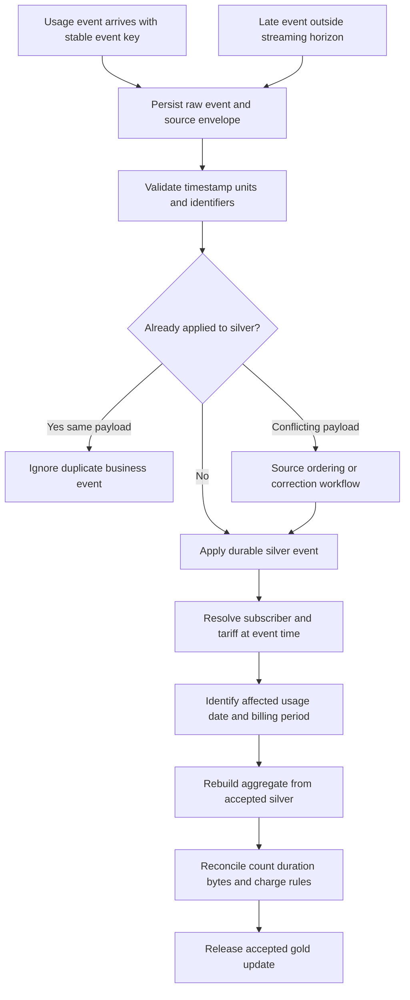


**Business meaning:** Transform high-volume telecom usage and subscriber/billing feeds into reliable analytical facts for usage, billing comparison, and network/service performance. The diagram highlights where the project-specific rules alter the data's meaning, grain or reporting status. Technical success at these stages does not substitute for the business control evidence described below.

### Worked record journey

An illustrative data-session event `CDR100` for subscriber `S100` occurs at 23:59 UTC and contains 1,024 bytes. Bronze stores the envelope and payload. Silver validates the event key and byte unit, resolves the subscriber/plan version effective at 23:59, and retains one accepted usage event.

If the same event is replayed three times, its durable business key ensures the daily count stays one and bytes stay 1,024. A streaming watermark only bounds in-memory state; it does not replace durable protection against a replay that arrives days later. If a correction has a higher approved source sequence, the silver record changes and the affected daily aggregate is rebuilt from the accepted event set.

The usage date follows the agreed UTC or local business-date policy. Billing-period comparison uses the actual approved tariff rules, including bundles, rounding and promotions. The daily usage dataset may be provisionally current while a billing-period product waits for completeness; its consumer status must make that distinction visible. For a broker outage beyond retention, retained raw/archive data and source recovery supply the missing events.

The example is synthetic and demonstrates behavior, not actual client data or a measured client outcome. Trace a record using its source business key, source sequence, raw location, run ID, contract/rule version and accepted publication ID. Avoid putting sensitive payload values in general logs.

### Dependencies, scheduling and publication boundaries

The stream can persist bronze independently of reference availability. Historical enrichment and billing products require accepted subscriber/tariff versions. Billing comparison also requires complete approved billing-period extracts and rating rules.

Keep a dependency manifest for each publication. It should identify the accepted source/reference versions, transformed partition scope and resulting output version. A successful upstream run is usable only if its controls passed and its artifact matches the downstream contract. Run independent entities concurrently only within the approved resource/source limits; serialize publication where concurrent writers could conflict.

**Suggested parameter contract:** `entity_id`, `run_id`, `business_date` or bounded change range, `contract_version`, `rule_version`, `input_manifest_uri`, `output_stage_uri`, `environment`, and `replay_mode`. Validate values and allow-list identifiers. Use the same input/rule scope during a replay unless the run explicitly records an approved correction.

### Diagram 4: Lifecycle and acceptance states

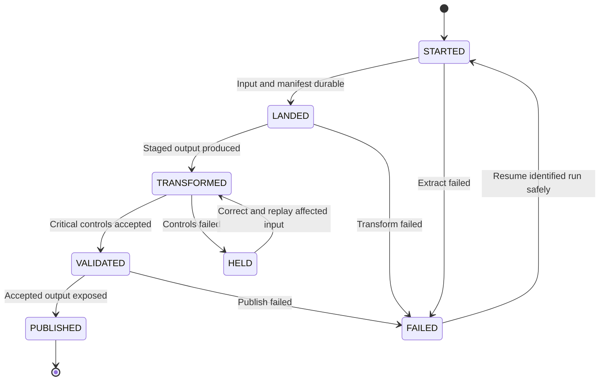


`STARTED` means a run exists; `LANDED` means its inputs are durable; `TRANSFORMED` means a candidate output exists; `VALIDATED` means the critical checks passed; `PUBLISHED` means consumers can read the accepted output. `HELD` indicates a deliberate business/control stop and `FAILED` indicates an execution failure. Extend this file's example control-table status constraint if you implement these additional states. The diagram is a recommended lifecycle, not a claim that the existing example DDL already includes every state.

Track state transitions with timestamps, actor/workload identity, reason and artifact IDs. A retry is an attempt tied to the original business input. Replaying a publication should not create extra fact rows, duplicate daily aggregates or misleading extra accepted runs.

### Diagram 5: Error handling, late correction and recovery

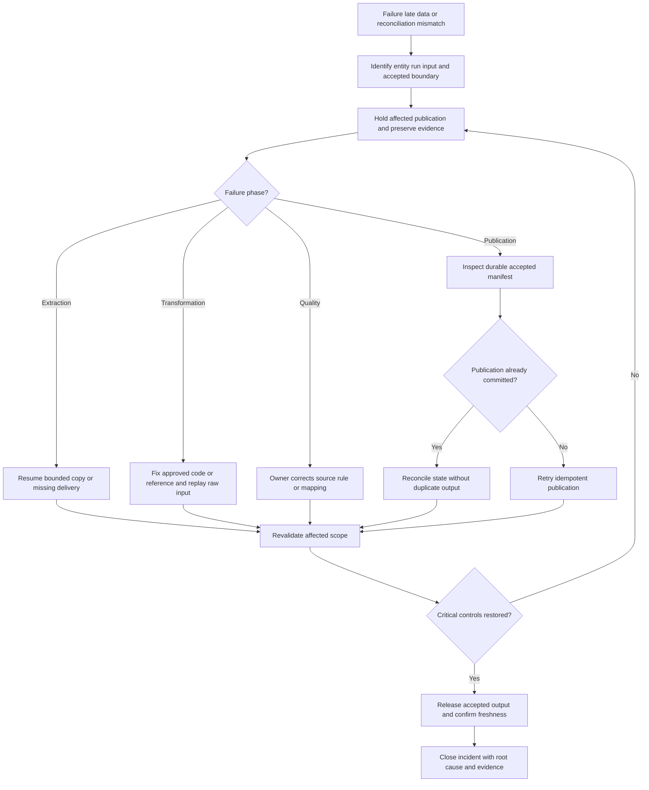


**Project recovery scenario:** A stream restarts and replays an older CDR batch. Reuse its durable checkpoint where valid, deduplicate against stable event keys, reconcile the impacted days, and rebuild those gold dates. If offsets expired, recover from retained raw data rather than assuming Event Hubs still contains the events.

Before retrying, determine whether the failure occurred before or after publication. A run can publish successfully and fail while recording its state; a blind repeat can double-count outputs. Inspect the accepted manifest, compare expected key/count/control evidence, and complete or roll back the recorded state safely. Missing or corrupt inputs require source correction; transformation fixes require versioned code; business-control failures require the relevant owner's resolution.

For a late correction, identify affected event dates, historical dimension intervals and dependent aggregate/reporting periods. Recompute the smallest complete business scope rather than updating only an arbitrary file. Preserve old publication metadata and make consumer as-of/revision information clear.

### Diagram 6: Identity, access and governance flow

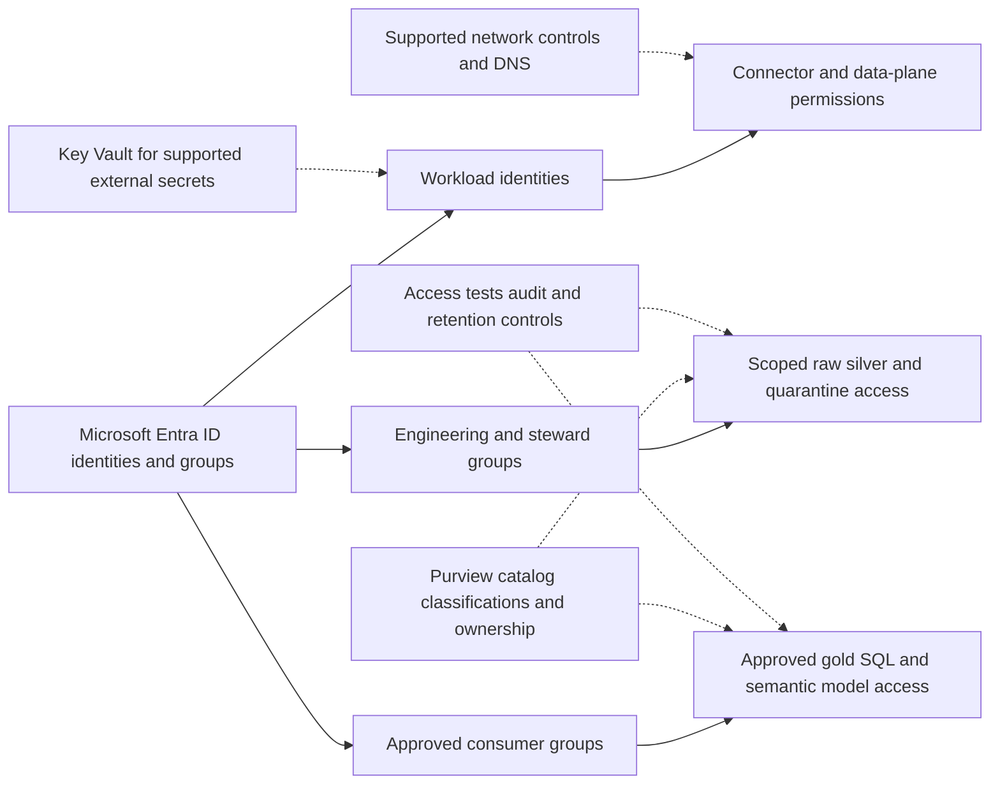


Permissions are enforced at the workload, storage/catalog and serving layers used by this project. The catalog documents ownership and classification; permissions still need implementation and testing. Validate engineer, workload, steward and consumer paths independently, including raw, quarantine, direct SQL and dashboard exports. A masked dashboard does not justify unrestricted raw access.

Use approved identities for source connections and pipeline execution. Key Vault applies to supported external-secret scenarios; configure Fabric connection credentials through supported mechanisms rather than assuming Azure managed identity works identically for every connector. Network restrictions, retention and residency settings are environment-specific controls to verify during deployment.

### Diagram 7: Development-to-production deployment flow

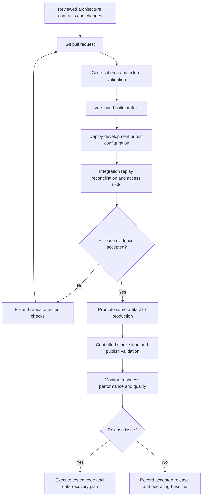


Create source contracts, physical schemas and fixtures before building the complete pipeline. Deploy infrastructure and configuration first, then compatible tables and transformations, then orchestration and serving objects. Test one vertical slice before adding volume or source variants. Promote reviewed artifacts with separate environment parameters and identities. Confirm the selected Azure/Fabric item's deployment support instead of assuming every object uses the same release mechanism.

Production smoke validation checks source reachability, identity permissions, small bounded processing, accepted publication and consumer reads. If a release changes stored data/schema, the rollback plan must cover those data changes as well as code. Record who owns the decision and where the recovery evidence is stored.

### Consumer request and reporting behavior

Network/usage analysts read daily subscriber/service aggregates with accepted as-of and completeness metadata. Billing analysts read period-level comparison products with the relevant tariff/rule version. Subscriber/location fields are masked or restricted according to their approved access scope.

Every product should expose its grain, accepted as-of boundary, revision/contract version, freshness status, business owner and access route. Serving queries should select accepted output; do not expose unvalidated staging by accident. If multiple datasets publish independently, the report must handle and display their differing as-of dates.

### Observability from ingestion through consumption

| Layer | What to record or measure | What the signal establishes |
|---|---|---|
| Source/landing | Boundary, delivery IDs, source counts, manifests, completeness | Whether all expected input arrived |
| Transformation | Rule/code version, input/output scope, rejected rows, duration | Which logic ran on which records |
| Validation | Key coverage, decimal totals, rule results, accepted status | Whether the output meets its contract |
| Publication | Dataset version, accepted boundary, publication ID | Exactly what consumers can read |
| Consumption | Access-test outcomes, serving errors, query latency | Whether authorized users can use the product |
| Recovery | Failed phase, replay input, replacement publication, controls | Whether service was restored correctly |

Measure broker lag, processing latency, state-store size, checkpoint health, data skew and aggregation cost. Tune stream partitioning and microbatch work based on observed throughput; keep reference-feed scheduling and expensive historical rebuilds from blocking raw event capture.

Alert on accepted-data age as well as job failure. A pipeline can finish successfully while a source feed is stale or the product remains held. Dashboard a last accepted timestamp and business freshness target, and route each alert to its actual owning team.

### Project-specific completion and interview evidence

- Replay duplicate events both inside and outside the watermark horizon; prove durable publication does not double count.
- Test out-of-order events, malformed timestamps, plan changes at midnight and tariff version overlaps.
- Compare aggregate duration/bytes/counts with source controls using compatible units and dates.
- Simulate checkpoint recovery and a source outage longer than broker retention using a retained archive.
- Demonstrate normal flow, rejected flow, duplicate replay and a late correction using synthetic/approved fixtures.
- Verify the diagram against deployed resources, connections, code and actual publication artifacts.
- Keep one accepted-run evidence packet linking manifest, controls, serving dataset and consumer acceptance.
- Replace illustrative names, example dates, sources and targets with verified engagement details before discussing them as past experience.

**Interview explanation:** draw Diagram 1, describe the worked record journey, identify your own implemented stages, explain Diagram 3's business rules, show how the critical gate protects publication, then use Diagram 5 to explain a concrete recovery. Finish with the verified output and a measured result supported by evidence.

### Plain-text fallback flow

All diagrams are embedded directly below their corresponding project sections using Mermaid. Markdown viewers with Mermaid support display them inline. The original architecture section and the following text retain the core flow in those viewers:

```text
CDR/session producers --> Event Hubs --> Databricks checkpointed stream --> bronze Delta; billing/subscriber files --> ADF --> ADLS --> bronze; bronze --> silver usage + dimensions --> gold daily facts --> Databricks SQL / Power BI
1. Confirm source contract and accepted dependencies.
2. Persist identifiable raw input and manifest.
3. Apply ordered, versioned business transformations.
4. Validate critical rules and source-to-target controls.
5. On failure: hold -> investigate -> correct -> replay -> revalidate.
6. On acceptance: publish -> record accepted boundary -> expose to consumers.
7. Monitor freshness, correctness, access, performance and recovery.
```

<!-- DEEP_NOTES_START -->

## Extended project notes: source, model, dependencies and serving

### Diagram 8: Individual source-to-bronze ingestion

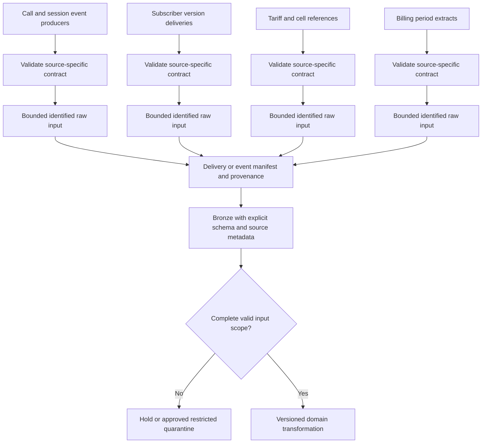

Validate each source separately before combining its records. Database changes, manifested files and event deliveries have different completeness/replay semantics. Preserve source keys, boundary and arrival metadata even after standardization.

### Diagram 9: Transformation dependency graph

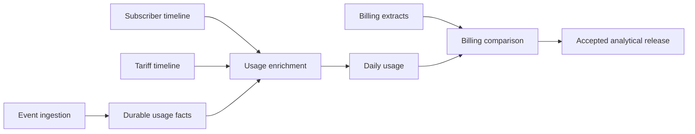

An arrow means the downstream stage requires an accepted upstream artifact/version. This is the business dependency graph, not proof that all upstream systems run on a single schedule. Record version/as-of dependencies for independently published data.

### Diagram 10: Logical data relationships

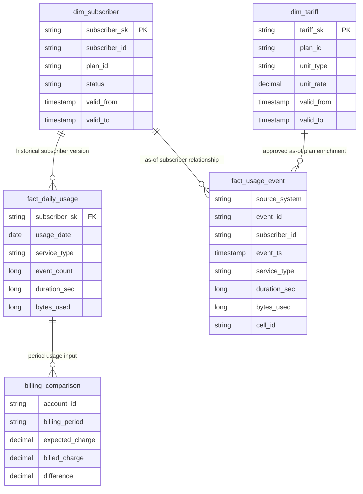

The ER view shows logical analytical relationships, not deployed foreign-key enforcement. Some edges express as-of or control-scope relationships rather than direct physical foreign keys. Reconcile this view with the model dictionary and actual physical schemas; composite uniqueness follows the stated grain.

### Diagram 11: Accepted publication-to-consumer flow

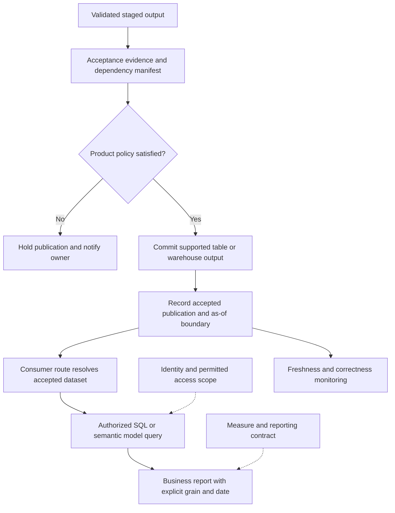

The consumer product is accepted daily usage and billing-comparison products. Define how the actual serving route selects accepted data. A manifest alone does not secure or atomically switch readers; implement compatible views/version selection/transactions for the chosen engine and validate concurrent reads.

### Diagram 12: Historical correction and dependent rebuild

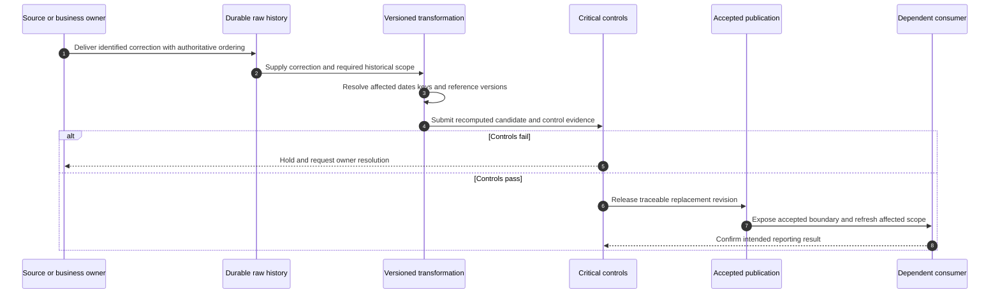

Correction scope includes event business date, subscriber/tariff timeline and billing period. Source arrival time does not automatically determine the historical business period affected. Preserve prior acceptance metadata, use authoritative ordering and verify downstream refresh behavior.

### Detailed implementation decisions and operating notes

#### 1. Producer contract

Specify stable event ID, partition/business key, source sequence, timestamp timezone and units. Kafka/Event Hubs transport offsets describe arrival order, while the producer contract establishes business correction ordering.

#### 2. Raw persistence

Capture events to durable bronze independently of reference availability. One durable checkpoint belongs to each stream/environment. Broker retention is finite; retained raw/capture/source recovery must cover the agreed outage risk.

#### 3. Deduplication

A watermark bounds supported streaming state; it does not protect forever against old replay. Preserve durable business-key/sequence semantics in silver and handle contradictory payloads under the correction policy.

#### 4. Historical enrichment

Resolve subscriber, plan and tariff versions using event time. Test interval boundaries and overlaps. Missing reference can hold enrichment while raw capture continues, so source events are not lost awaiting a dimension.

#### 5. Usage and rating

Normalize seconds/bytes and usage-date semantics, then aggregate accepted usage at the stated grain. Expected billing charges require approved tariff/bundle/promotion/rounding rules; a simple rate multiplication is not a complete billing engine.

#### 6. Late corrections

Identify affected event dates and billing periods, rebuild those outputs from accepted silver, reconcile counts/units and record replacement publication. Mark operational freshness and billing completeness separately.

### Pipeline/notebook contract and evidence packet

Every transformation should receive an identified input scope and produce an identified candidate. Suggested logical fields are `run_id`, `attempt_id`, `entity_id`, source boundary or delivery ID, business-date range, contract version, code/rule version, reference versions and output location. Validate paths/identifiers and bind values using supported APIs. These are recommended control fields, not an existing deployed application interface.

Persist input completeness, accepted/rejected/duplicate/conflict counts and the applicable reconciliation totals. Do not conflate a retried attempt with a new source business delivery. A publish decision records which candidate and dependencies were accepted. If table writes and the control store are separate systems, reconcile the outcome after a crash; avoid claiming a distributed atomic commit that the implementation does not provide.

### Synthetic acceptance fixtures

| Case | Input or fault | Expected behavior |
|---|---|---|
| Duplicate CDR100 | 1024-byte event replays three times | One accepted event and 1024-byte contribution |
| Late beyond horizon | Event older than stream state | Durable key/replay process prevents duplication |
| Plan boundary | Usage just before plan change | Old plan version used at event time |
| Bad units | Bytes field supplied with ambiguous unit | Quarantine or reject under explicit contract |
| Broker expiry | Consumer resumes after retained offsets expire | Recover approved raw/source scope and reconcile |
| Billing incomplete | Usage exists but billing extract absent | Usage status may differ from held billing product |

Retain the input, expected business result, actual result, rule/reference versions and run/publication IDs for each fixture. Cases are proposed tests and have not executed against cloud resources. Add representative volume/concurrency checks after the correctness cases pass.

### Normal-day operating walkthrough

1. Check expected source deliveries/events and the last accepted business boundary.
2. Verify required reference/dependency versions, execution identity and resource availability.
3. Land durable input and record its manifest/provenance.
4. Transform the bounded scope and preserve restricted exception evidence.
5. Evaluate keys, reference coverage, quality and source-to-target totals.
6. Publish only the accepted scope and record the consumer-visible as-of/revision.
7. Verify consumer access and business queries; monitor accepted-data age and resource cost.

### Incident walkthrough and ownership

The source owner resolves missing/corrected deliveries and source business semantics. The engineer resolves extraction/processing/target behavior. The data steward resolves approved reference/quality exceptions. The product/reporting owner accepts the consumer result. Assign actual teams and escalation routes before production; these are responsibilities to fill in, not assumed client organization details.

For an incident, identify its impacted product and last accepted boundary before rerunning anything. Preserve raw input, code/configuration version and the failed control. Determine whether publication already happened. Recover the smallest complete business scope, revalidate, then verify the dependent report/API result. A green pipeline without restored accepted freshness does not close the incident.

### Performance and cost evidence to collect

Measure extraction, source pressure, listing/read throughput, transformation/shuffle time, target writing, reconciliation and serving queries separately. Capture the workload boundary and concurrency with each benchmark. Tune a demonstrated bottleneck, compare equivalent before/after cases, and retain correctness/recovery checks. No volumes, capacity sizes or percentage savings in these notes are verified client metrics.

### Explain the whole flow during an interview

Start with the business output and its grain. Draw the full architecture and the source-specific flow. Explain the dependency order and one historical/reference join. Show the accepted-publication path and a consumer query. Walk through a correction using Diagram 12, then show one acceptance fixture and the evidence that would prove the result. State precisely which parts you personally performed when discussing actual employment.

## Embedded implementation reference

This is a reference implementation guide for the six proposed project designs. Code uses illustrative tables and schemas. It requires Azure resources, approved source access, runtime configuration and synthetic/approved test data; the Markdown files do not provision or run Azure services.

### 1. Build sequence

1. Select one project and define a minimal vertical slice: one source entity, one transformation, one validated gold dataset and one consumer query.
2. Create a development Azure resource group, ADLS Gen2 account with hierarchical namespace, ADF instance, Azure SQL metadata database, Key Vault and Databricks workspace. For the Fabric project create licensed/capacity-backed Fabric workspaces and Lakehouses instead of assuming an Azure storage account is OneLake.
3. Assign workload identity permissions, catalog/table grants, storage ACLs and source access. Validate networking and DNS. Create separate development/test/production configurations before deployment.
4. Create raw paths and bronze/silver/gold Delta tables with explicit schemas. In Databricks use Unity Catalog storage credentials/external locations as appropriate; in Fabric attach the correct Lakehouse to the notebook.
5. Create control tables, register an approved entity and seed its initial boundary. Load a small synthetic snapshot, including intentionally invalid and duplicate records.
6. Build the source extraction pipeline, notebook transformations, reconciliation and publication gate. Record durable input and output locations for every run.
7. Implement one insert, update, delete and late-arrival scenario. Replay input twice. Validate the accepted result and recovery after a simulated failure.
8. Create a serving view/semantic model and validate both its numbers and access with consumer identities.
9. Add monitoring, CI/CD, infrastructure code, deployment parameters, operating procedures and a measured performance/cost baseline.
10. Scale only after correctness passes; use the project-specific acceptance controls before declaring completion.

### 2. Storage and metadata contracts

```text
landing/<source>/<entity>/business_date=YYYY-MM-DD/run_id=<uuid>/
bronze/<domain>/<entity>/                  # raw records plus ingestion metadata
silver/<domain>/<entity>/                  # conformed business records
gold/<product>/<dataset>/                  # accepted analytical datasets
quarantine/<domain>/<entity>/run_id=<uuid>/ # restricted failed records
checkpoints/<stream_name>/                 # one durable path per stream
```

These are ADLS examples. Fabric Files/Tables organization and managed catalog tables have their own locations. Do not manually move files inside a managed Delta table. Avoid subscriber/customer ID partitions; choose partitioning only after measuring date filtering, volume and file sizes.

```sql
-- Azure SQL orchestration metadata; add access, indexing and retention policies.
CREATE TABLE dbo.entity_state (
 entity_id varchar(100) PRIMARY KEY,
 accepted_watermark datetime2(7) NULL,
 accepted_run_id uniqueidentifier NULL,
 state_version rowversion
);
CREATE TABLE dbo.pipeline_run (
 run_id uniqueidentifier PRIMARY KEY,
 entity_id varchar(100) NOT NULL,
 old_watermark datetime2(7) NULL,
 new_watermark datetime2(7) NULL,
 status varchar(20) NOT NULL,
 source_count bigint NULL,
 target_count bigint NULL,
 started_at datetime2(7) NOT NULL,
 ended_at datetime2(7) NULL,
 CONSTRAINT CK_run_status CHECK
  (status IN ('STARTED','LANDED','VALIDATED','PUBLISHED','FAILED'))
);
```

Acquire a per-entity lease or use a serialized scheduler so two runs cannot publish the same boundary concurrently. Restrict configuration changes to reviewed values; table identifiers need allow-list validation because SQL parameters do not parameterize object names.

### 3. ADF incremental orchestration

```text
Lookup approved entity configuration
  -> acquire entity lock
  -> read last accepted boundary
  -> capture bounded source upper boundary
  -> create STARTED run record
  -> Copy bounded source rows into immutable run directory
  -> validate landing manifest / mark LANDED
  -> invoke Databricks notebook
  -> quality checks + reconciliation / mark VALIDATED
  -> publish accepted product
  -> compare-and-set accepted boundary / mark PUBLISHED
  -> release lock
Failure path: mark FAILED + preserve input + alert owner + release lock
```

For Fabric use supported Fabric pipeline/notebook/control-state mechanisms rather than assuming every ADF activity or connector is identical.

```sql
-- Bounded example query; timestamp semantics must be agreed with the source.
SELECT transaction_id, source_sequence, modified_at, amount, currency_code
FROM dbo.source_transaction
WHERE modified_at > @old_watermark
  AND modified_at <= @new_watermark;
```

A timestamp alone is safe only if the source's commit/update behavior guarantees it. Concurrent or late commits can otherwise fall behind the accepted boundary. Prefer source-supported CDC or consistent snapshots with a commit-ordered change boundary. If using a lookback overlap, deduplicate it and document residual risks. Use a timestamp plus key cursor for deterministic page ordering; this does not fix backdated updates or deletes. Timestamp extraction cannot detect hard deletes without a deletion feed or complete-snapshot comparison.

Advance state only after successful acceptance. Publication and Azure SQL state are usually in different transaction systems: use a durable publication manifest and idempotent reconciliation so a crash between them can resume safely. Never claim they are one atomic distributed transaction.

### 4. PySpark validation and deterministic deduplication

```python
from pyspark.sql import functions as F, Window

## `input_path`, `quarantine_path`, `silver_table` and `run_id` are validated job parameters.
schema = ('transaction_id STRING, line_id STRING, source_system STRING, '
          'source_sequence LONG, modified_at TIMESTAMP, '
          'amount DECIMAL(28,6), currency_code STRING')
raw = (spark.read.schema(schema).option('mode', 'FAILFAST')
       .json(input_path).withColumn('run_id', F.lit(run_id)))
## FAILFAST fails the batch for malformed JSON. An alternative permissive
## parser must explicitly capture corrupt records and quarantine them.
invalid = (F.col('transaction_id').isNull() | F.col('line_id').isNull()
           | F.col('source_system').isNull() | F.col('source_sequence').isNull()
           | F.col('modified_at').isNull() | F.col('amount').isNull()
           | F.col('currency_code').isNull())
bad = raw.where(invalid)
good = raw.where(~invalid)
bad.write.format('delta').mode('overwrite').save(quarantine_path)

keys = ['source_system', 'transaction_id', 'line_id']
## Assert one payload per key + source_sequence; contradictory ties fail
## rather than being silently chosen by nondeterministic ordering.
conflicts = (good.groupBy(*(keys + ['source_sequence']))
             .agg(F.countDistinct(F.struct('amount', 'currency_code',
                                          'modified_at')).alias('payloads'))
             .where('payloads > 1'))
if conflicts.limit(1).count():
    raise ValueError('Conflicting payloads for a source sequence')
window = Window.partitionBy(*keys).orderBy(F.col('source_sequence').desc())
latest = (good.dropDuplicates(keys + ['source_sequence'])
          .withColumn('rn', F.row_number().over(window))
          .where('rn = 1').drop('rn'))
latest.createOrReplaceTempView('transaction_latest')
```

Implement format, membership, uniqueness and reconciliation rules separately; null checks alone are not a complete quality framework. The subsequent MERGE target must already exist with a compatible schema. Run the critical quality gate before publication; a valid-row table may be staged even when the batch is held.

### 5. Delta upsert and deletion semantics

```sql
-- Spark SQL / Azure Databricks Delta; source is deduplicated and ordered.
MERGE INTO silver.transaction AS t
USING transaction_latest AS s
ON t.source_system = s.source_system
 AND t.transaction_id = s.transaction_id AND t.line_id = s.line_id
WHEN MATCHED AND s.source_sequence > t.source_sequence THEN UPDATE SET *
WHEN NOT MATCHED THEN INSERT *;
```

Keep the source sequence on each current record. A later-arriving older update must not overwrite a newer one. For physical deletes, retain ordering in a tombstone ledger or soft-deleted current row if stale events can be replayed; otherwise an old insert can resurrect a deleted entity. Use delete operations only from an explicit CDC contract or an authoritative complete snapshot, never from absence in a partial batch.

Delta change data feed exposes changes already written to Delta. Enable/configure the supported CDF mode for the chosen Databricks runtime, checkpoint consumers, and plan retention/backfills. Do not promise indefinite history or assume Azure Databricks-specific CDF modes are readable in Fabric.

### 6. SCD Type 2 and historical joins

Choose an entity business key, tracked attributes and effective-time source. Use half-open intervals `[valid_from, valid_to)` and a sentinel or null end date. Assert no overlapping intervals and at most one current row per key.

```sql
-- Spark SQL historical dimension lookup.
SELECT f.transaction_id, f.line_id, d.account_sk, f.amount
FROM silver.transaction f
LEFT JOIN silver.dim_account d
 ON f.account_id = d.account_id
 AND f.event_ts >= d.valid_from
 AND (d.valid_to IS NULL OR f.event_ts < d.valid_to);
```

Count matches: zero requires an approved unknown/suspense policy; more than one is a critical integrity failure. For an out-of-order dimension change, recompute that key's timeline from ordered source history and identify affected facts. A naive close-current-and-insert routine can misrepresent late history. Hashes can compare attributes but are not business keys or proof of equivalence without canonical types/null handling.

### 7. Streaming state and replay

Event Hubs ingestion uses its supported Spark integration for the selected runtime. Persist the original source identifier, event ID, event timestamp and producer sequence. Keep one durable checkpoint per query and environment. Validate connector/authentication options against the installed runtime.

```python
## `events` is an already parsed streaming DataFrame from the approved source.
deduped = (events.withWatermark('event_ts', '2 hours')
           .dropDuplicatesWithinWatermark(['source_system', 'event_id']))
query = (deduped.writeStream.format('delta')
         .option('checkpointLocation', checkpoint_path)
         .outputMode('append').start(bronze_delta_path))
```

The two-hour window is an illustrative configuration, not an SLA. Verify runtime support for `dropDuplicatesWithinWatermark`; if unavailable use an explicitly designed alternative with measured state behavior. Windowed deduplication expires state and can accept replays beyond the horizon. Enforce durable business-key idempotency in silver, retain raw data, and reconcile late partitions. `foreachBatch` handlers must be idempotent because microbatches can execute again; a checkpoint alone does not make arbitrary external writes exactly once.

### 8. Financial and operational reconciliation

Record expected and observed counts and decimal totals at matching grain. Counts alone can miss a duplicated row replacing a missing row. Combine key uniqueness, missing-key comparisons, signed totals, reference coverage and independent samples.

| Control | Expected evidence | Failure action |
|---|---|---|
| Manifest completeness | Declared files/rows vs landed files/rows | Hold batch and request missing delivery |
| Key uniqueness | Distinct business keys equal accepted record count | Resolve source duplicates/conflicts |
| Financial amounts | Decimal totals by date/entity/currency | Hold publication and investigate |
| Dimension resolution | Exactly one historical match per eligible fact | Fix timeline or agreed suspense policy |
| Freshness | Last accepted business timestamp vs target | Alert owner even if jobs succeeded |
| Replay | Same input creates same business output | Fix idempotency before go-live |

Define tolerance from an approved rounding/accounting policy; do not use an arbitrary percentage to suppress differences. Keep rejected-row counts in the balance equation. Test `source = accepted + rejected` where the extract contract and deduplication rules make that equation applicable.

### 9. CI/CD and infrastructure

Suggested repository structure:

```text
infra/                 # Bicep/Terraform, parameters, network/identity declarations
pipelines/             # ADF/Fabric definitions and deployment configuration
notebooks/             # parameterized PySpark transformations
sql/                   # metadata DDL and engine-specific serving objects
contracts/             # reviewed schemas and data-product definitions
tests/fixtures/        # synthetic examples and expected outputs
tests/integration/     # connectivity/replay/reconciliation scenarios
monitoring/            # queries, dashboards and alert definitions
runbooks/              # recovery, access and cutover procedures
```

PR validation checks code/contracts and meaningful fixtures. Test deployment creates resources/configuration and executes the vertical slice. Production promotion uses a reviewed artifact, environment identity, approved parameters and release evidence. Fabric Git/deployment support differs by item type; verify the actual items before promising fully automated promotion. Migration rollback can require recovering data, not just reverting a notebook.

### 10. Performance, costs and observability

Measure extraction bottleneck, shuffle volume, skew, file counts, read amplification, concurrency and serving query latency. Tune one measured bottleneck at a time. Do not apply repartition, caching, broadcast joins, clustering or partitioning mechanically. Avoid tiny files and full-table scans in daily incremental jobs. Run maintenance only under the retention policy; aggressive VACUUM can remove replay/time-travel data still needed by consumers.

Monitor pipeline failure, accepted-data age, reconciliation difference, quarantine rate, streaming lag, execution duration and cost per accepted batch. Use ADF diagnostics and Azure logs where available; use Fabric monitoring and capacity metrics for Fabric workloads rather than assuming all internal events automatically appear in Log Analytics. Benchmark representative data and concurrency and retain before/after results.

### 11. Production recovery runbook

1. Identify the failed run, entity, boundary, input manifest and affected consumers.
2. Prevent concurrent publication for the affected entity; preserve raw input and error evidence.
3. Determine whether landing, transformation, quality, serving publication or state update failed.
4. Resume from the durable phase using the same business input. If publication succeeded but state did not, reconcile the manifest and advance state without appending duplicate facts.
5. Revalidate keys, amounts, quality and access; release only the accepted output.
6. Confirm freshness restored, communicate through the approved incident route, and document root cause and prevention.

Recovery objectives must be backed by tested infrastructure/data restoration. Delta time travel alone is not a complete disaster recovery strategy. Agree source retention, checkpoints, configuration backups, identity/network recovery and regional constraints.

### 12. Completion checklist and evidence form

- [ ] Source owner and data-product owner confirmed.
- [ ] Source snapshot/change semantics documented, including deletes.
- [ ] Reconciliation, critical quality gates and access tests passed.
- [ ] Replay, partial failure, late data and schema-change scenarios passed.
- [ ] Deployment/rollback/recovery demonstrated in the target environment.
- [ ] Freshness, RPO/RTO and cost targets agreed and measured.
- [ ] Consumer acceptance recorded with run/publication IDs.

```text
Project / entity:
Input manifest / source boundary:
Contract / rule version:
Run ID / publication ID:
Source / accepted / rejected counts:
Reconciliation totals / differences:
Failure and replay evidence:
Performance baseline / result / measurement period:
Access test identities and outcomes:
Business acceptance owner and date:
```

### Official technical references

- [Fabric medallion lakehouse architecture](https://learn.microsoft.com/en-us/fabric/onelake/onelake-medallion-lakehouse-architecture)
- [Fabric end-to-end lakehouse tutorial](https://learn.microsoft.com/en-us/fabric/data-engineering/tutorial-lakehouse-introduction)
- [ADF incremental ingestion with watermarks](https://learn.microsoft.com/en-us/azure/data-factory/tutorial-incremental-copy-portal)
- [Azure Databricks MERGE reference](https://learn.microsoft.com/en-us/azure/databricks/sql/language-manual/delta-merge-into)
- [Azure Databricks change data feed](https://learn.microsoft.com/en-us/azure/databricks/delta/delta-change-data-feed)
- [Microsoft Purview governance setup](https://learn.microsoft.com/en-us/purview/data-governance-get-started)
